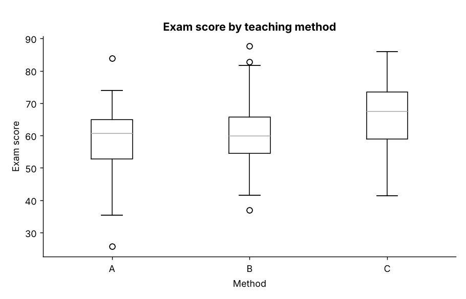
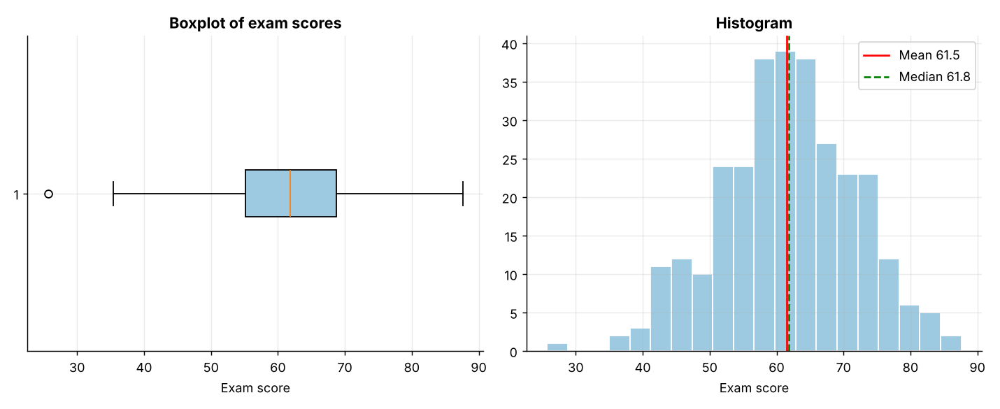
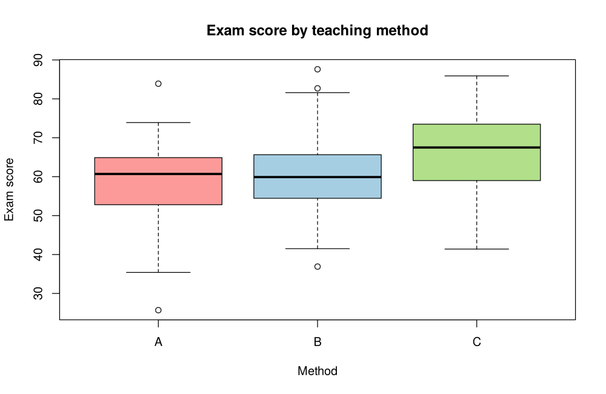
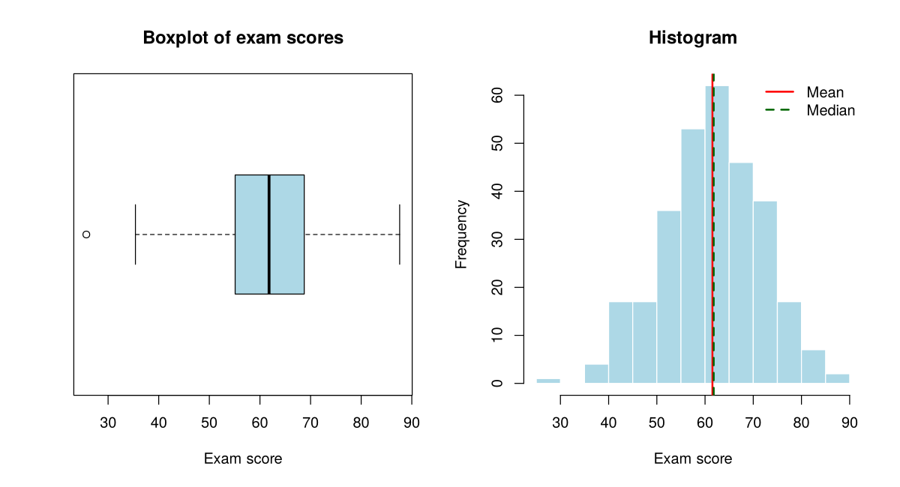

# Topic 1: Measures of central tendency and dispersion

**Course:** BIT 4131 Statistical Computing and Reporting

## 1. Theoretical explanation
Central tendency summarises where data is centred (mean, median, mode). Dispersion summarises how spread out it is (range, variance, standard deviation, quartiles/IQR). The mean is sensitive to outliers; the median is robust. A boxplot displays the five-number summary and flags outliers.

## 2. Mathematical formulation
- Mean: $\bar x=\frac1n\sum x_i$
- Sample variance: $s^2=\frac{1}{n-1}\sum (x_i-\bar x)^2$, standard deviation $s=\sqrt{s^2}$
- IQR $=Q_3-Q_1$; outlier fences $Q_1-1.5\,IQR$ and $Q_3+1.5\,IQR$
- Coefficient of variation $CV=s/\bar x\times100\%$

## 3. Worked example
Hand-checkable example (full code in the scripts below).

```text
WORKED EXAMPLE: data = [4, 8, 6, 5, 3, 8, 9]
mean     = 6.142857142857143 (sum 43 / 7)
median   = 6.0 (sorted 3 4 5 6 8 8 9 -> middle value)
mode     = 8 (appears twice)
variance = 5.1429 (sample, n-1)
std dev  = 2.2678
```

## 4. Dataset analysis and implementation
| Language | Script | Console output |
|---|---|---|
| Python | [`python/analysis.py`](python/analysis.py) | [`outputs/results_python.txt`](outputs/results_python.txt) |
| R | [`r/analysis.R`](r/analysis.R) | [`outputs/results_r.txt`](outputs/results_r.txt) |

Datasets are in [`/data`](../../data) (reproducible synthetic data generated by `data/generate_datasets.py`, seed 4131).

## 5. Expected statistical output
See the two `results_*.txt` files above for the complete printed output (tables, test statistics, p-values, estimates).

## 6. Interpretation and visualisation
- Mean (61.5) and median (61.8) are close, so the distribution is approximately symmetric.
- Typical students deviate about 10.2 marks from the mean; the middle 50% of scores span 13.6 marks.
- The boxplot flags 1 unusual score(s) beyond 1.5 x IQR from the quartiles.
- Method C has the highest centre, method A the lowest: spread is similar, centres differ.

### Figures
Files prefixed `py_` come from Python, `r_` from R.





