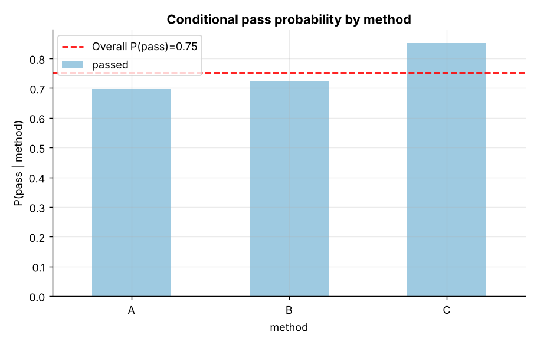
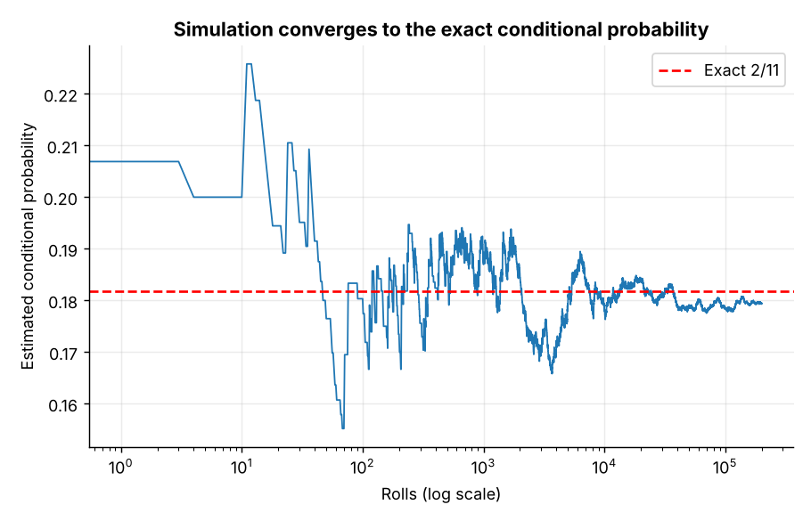
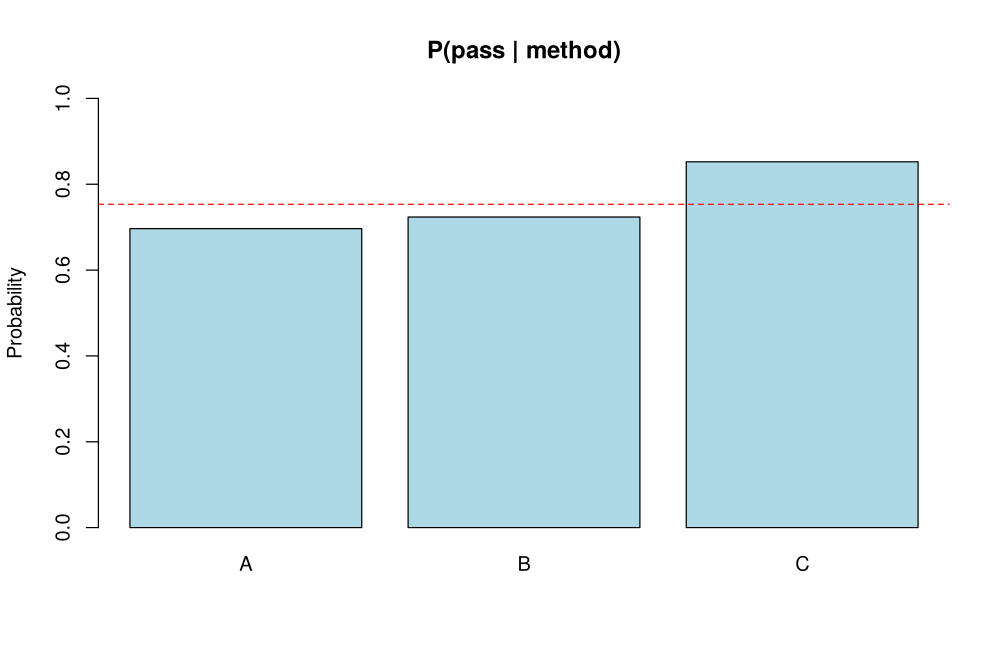
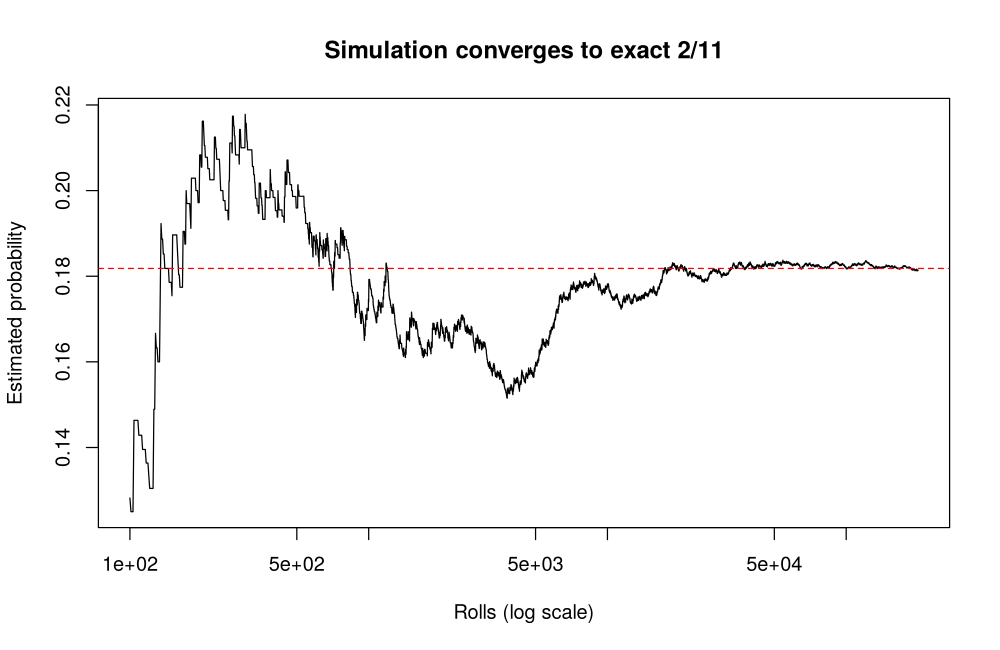

# Topic 2: Probability and conditional probability

**Course:** BIT 4131 Statistical Computing and Reporting

## 1. Theoretical explanation
Probability measures the likelihood of an event between 0 and 1. Conditional probability is the probability of an event given that another has occurred; events are independent when knowing one does not change the other. Simulation approximates probabilities by repeating a random experiment.

## 2. Mathematical formulation
- $P(A)=\frac{|A|}{|S|}$ for equally likely outcomes
- $P(A\mid B)=\frac{P(A\cap B)}{P(B)}$
- Multiplication rule: $P(A\cap B)=P(A\mid B)P(B)$; independence: $P(A\cap B)=P(A)P(B)$
- Bayes: $P(A\mid B)=\frac{P(B\mid A)P(A)}{P(B)}$

## 3. Worked example
Hand-checkable example (full code in the scripts below).

```text
WORKED EXAMPLE: two fair dice
P(sum = 7)                 = 0.1667
P(at least one 6)          = 0.3056
P(sum=7 AND at least one 6)= 0.0556
P(sum=7 | at least one 6)  = 0.1818 (= 2/11)
```

## 4. Dataset analysis and implementation
| Language | Script | Console output |
|---|---|---|
| Python | [`python/analysis.py`](python/analysis.py) | [`outputs/results_python.txt`](outputs/results_python.txt) |
| R | [`r/analysis.R`](r/analysis.R) | [`outputs/results_r.txt`](outputs/results_r.txt) |

Datasets are in [`/data`](../../data) (reproducible synthetic data generated by `data/generate_datasets.py`, seed 4131).

## 5. Expected statistical output
See the two `results_*.txt` files above for the complete printed output (tables, test statistics, p-values, estimates).

## 6. Interpretation and visualisation
- Overall pass probability is 0.75, but it rises from 0.70 (A) to 0.85 (C).
- Conditioning changes the probability, so method carries information about passing.
- The simulation matches the exact result 2/11, validating the Monte Carlo approach.

### Figures
Files prefixed `py_` come from Python, `r_` from R.





