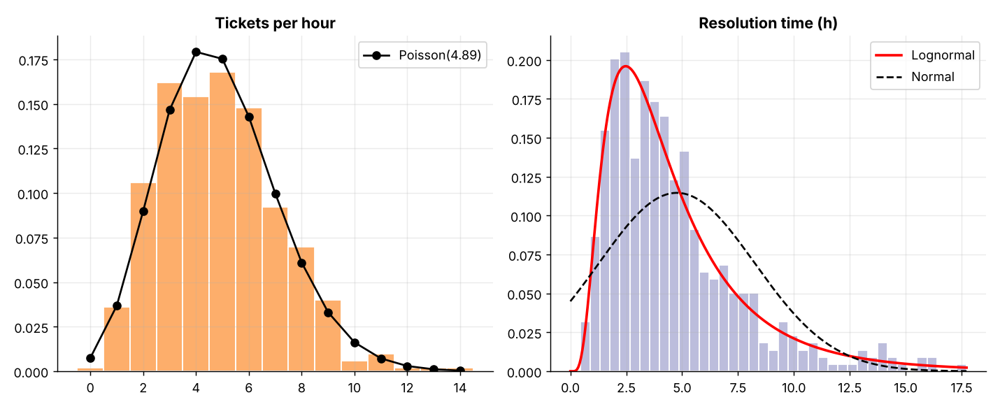
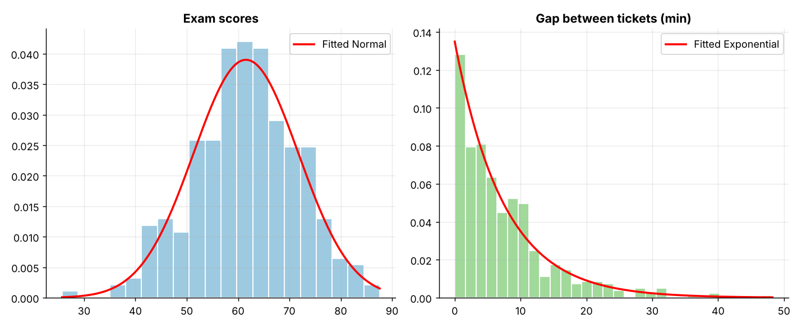
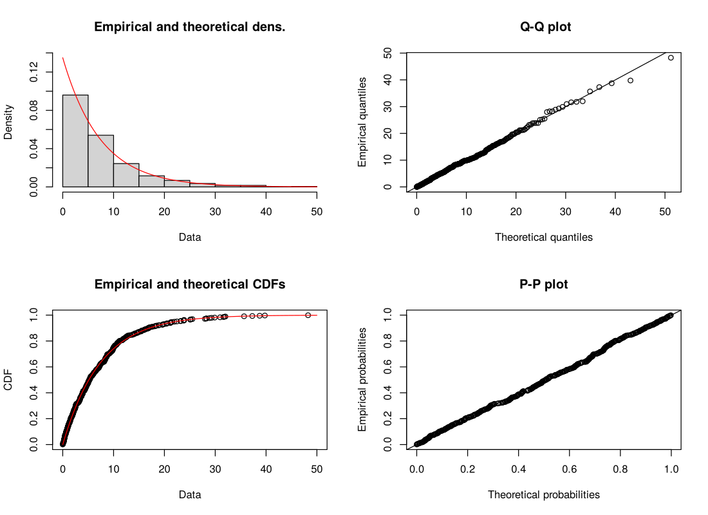
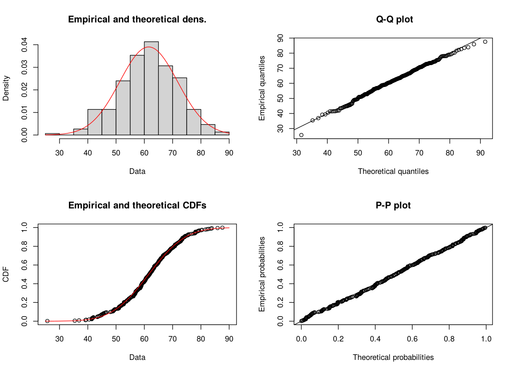
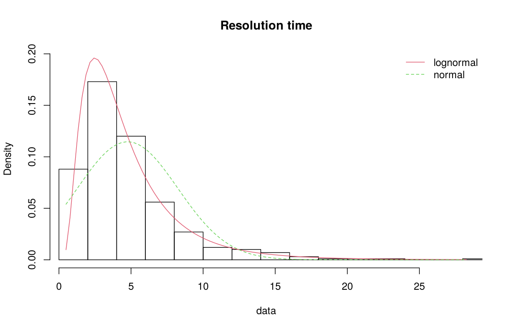

# Topic 3: Probability distributions

**Course:** BIT 4131 Statistical Computing and Reporting

## 1. Theoretical explanation
A distribution describes the probabilities of a random variable's values. Discrete examples: Binomial, Poisson. Continuous: Normal, Exponential, Lognormal. Fitting estimates the parameters from data and compares candidate models (histogram vs fitted curve, KS test, AIC).

## 2. Mathematical formulation
- Binomial: $P(X=k)=\binom nk p^k(1-p)^{n-k}$
- Poisson: $P(X=k)=\frac{\lambda^k e^{-\lambda}}{k!}$, mean $=$ variance $=\lambda$
- Normal: $f(x)=\frac{1}{\sigma\sqrt{2\pi}}e^{-(x-\mu)^2/2\sigma^2}$
- Exponential: $f(x)=\lambda e^{-\lambda x}$, mean $1/\lambda$
- AIC $=2k-2\ln L$ (lower is better)

## 3. Worked example
Hand-checkable example (full code in the scripts below).

```text
WORKED EXAMPLES
Binomial(n=10, p=0.3): P(X=3) = 0.2668 = C(10,3)(0.3)^3(0.7)^7
Poisson(lambda=5):      P(X<=3) = 0.265
Normal(60, 10):         P(50<X<70) = 0.6827
Exponential(mean 8):    P(X>10) = 0.2865
```

## 4. Dataset analysis and implementation
| Language | Script | Console output |
|---|---|---|
| Python | [`python/analysis.py`](python/analysis.py) | [`outputs/results_python.txt`](outputs/results_python.txt) |
| R | [`r/analysis.R`](r/analysis.R) | [`outputs/results_r.txt`](outputs/results_r.txt) |

Datasets are in [`/data`](../../data) (reproducible synthetic data generated by `data/generate_datasets.py`, seed 4131).

## 5. Expected statistical output
See the two `results_*.txt` files above for the complete printed output (tables, test statistics, p-values, estimates).

## 6. Interpretation and visualisation
- Exam scores fit a Normal(mu=61.5, sigma=10.2); KS p = 0.86 gives no evidence against it.
- Gaps between tickets follow an Exponential with mean 7.4 min (memoryless waiting times).
- Hourly ticket counts have mean 4.89 close to variance 5.06: consistent with Poisson.
- Resolution times are right-skewed; the lognormal beats the normal by AIC.

### Figures
Files prefixed `py_` come from Python, `r_` from R.






