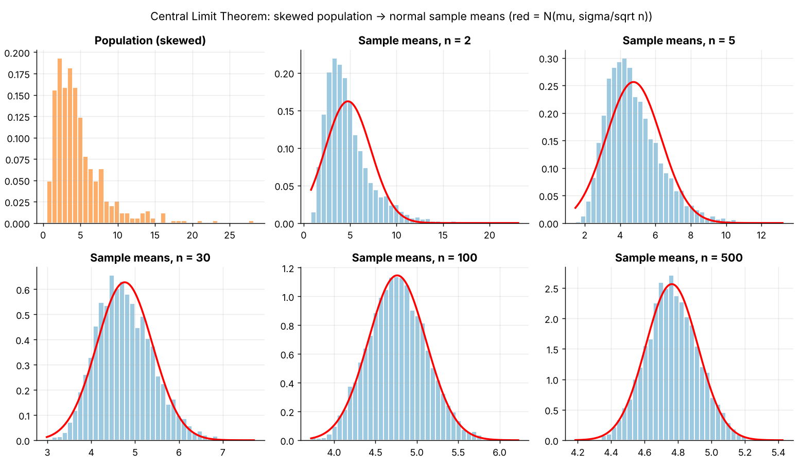
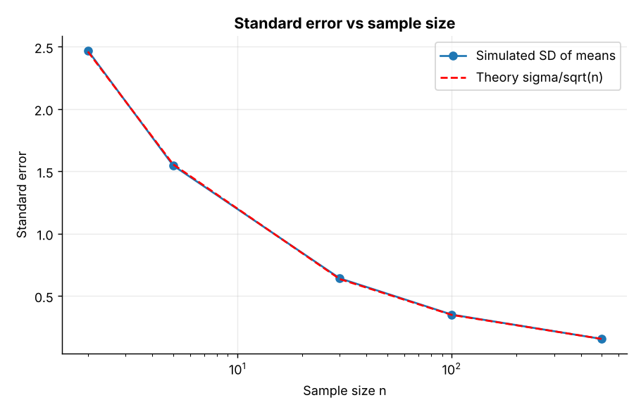
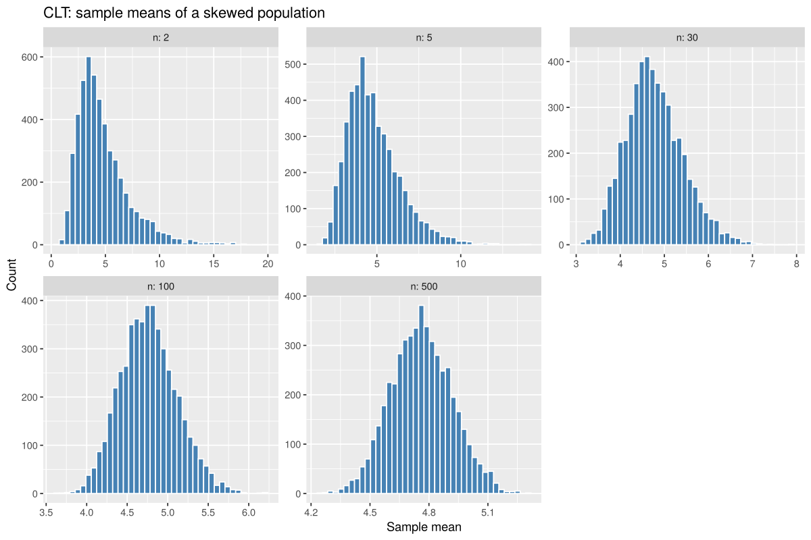
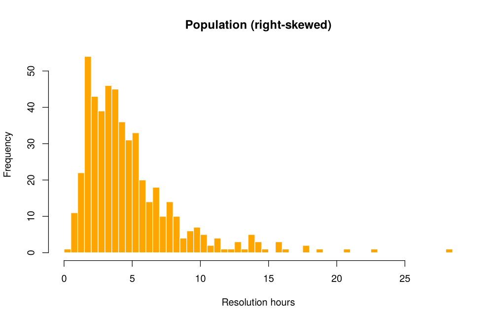
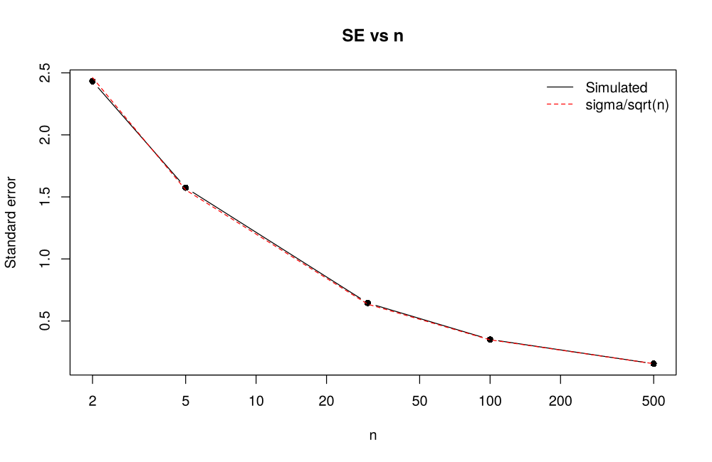

# Topic 4: Sampling distributions and the Central Limit Theorem

**Course:** BIT 4131 Statistical Computing and Reporting

## 1. Theoretical explanation
A sampling distribution is the distribution of a statistic (e.g. the mean) over repeated samples. The CLT says the distribution of the sample mean approaches a Normal distribution as n grows, whatever the shape of the population (finite variance). The standard error shrinks like $1/\sqrt n$.

## 2. Mathematical formulation
- $E[\bar X]=\mu$, $SE(\bar X)=\frac{\sigma}{\sqrt n}$
- CLT: $\frac{\bar X-\mu}{\sigma/\sqrt n}\xrightarrow{d}N(0,1)$ as $n\to\infty$

## 3. Worked example
Hand-checkable example (full code in the scripts below).

```text
WORKED EXAMPLE: standard error
Population mean mu = 4.763, sigma = 3.481, skewness = 2.23
For n = 30: SE = sigma/sqrt(n) = 3.481/5.477 = 0.6355
```

## 4. Dataset analysis and implementation
| Language | Script | Console output |
|---|---|---|
| Python | [`python/analysis.py`](python/analysis.py) | [`outputs/results_python.txt`](outputs/results_python.txt) |
| R | [`r/analysis.R`](r/analysis.R) | [`outputs/results_r.txt`](outputs/results_r.txt) |

Datasets are in [`/data`](../../data) (reproducible synthetic data generated by `data/generate_datasets.py`, seed 4131).

## 5. Expected statistical output
See the two `results_*.txt` files above for the complete printed output (tables, test statistics, p-values, estimates).

## 6. Interpretation and visualisation
- The population is strongly right-skewed (skew 2.23) and clearly non-normal.
- At n=2 the means are still skewed (1.52); by n=100 the skew is 0.13, close to a bell shape.
- The mean of the sample means equals the population mean (unbiased), and their SD matches sigma/sqrt(n).
- Quadrupling n halves the standard error: precision grows with the square root of sample size.

### Figures
Files prefixed `py_` come from Python, `r_` from R.






