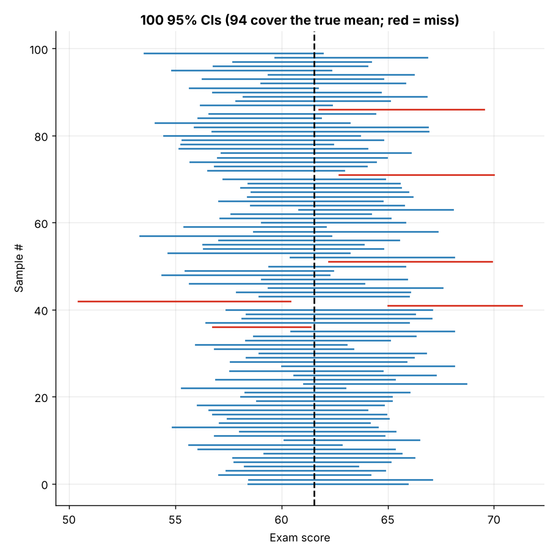
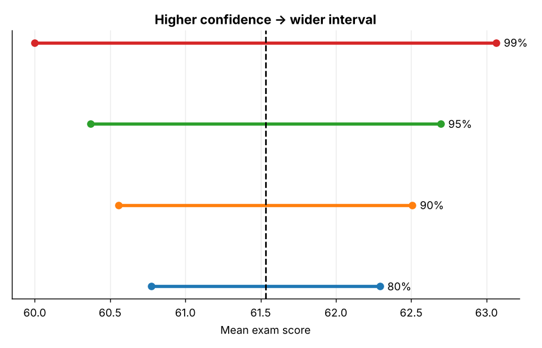
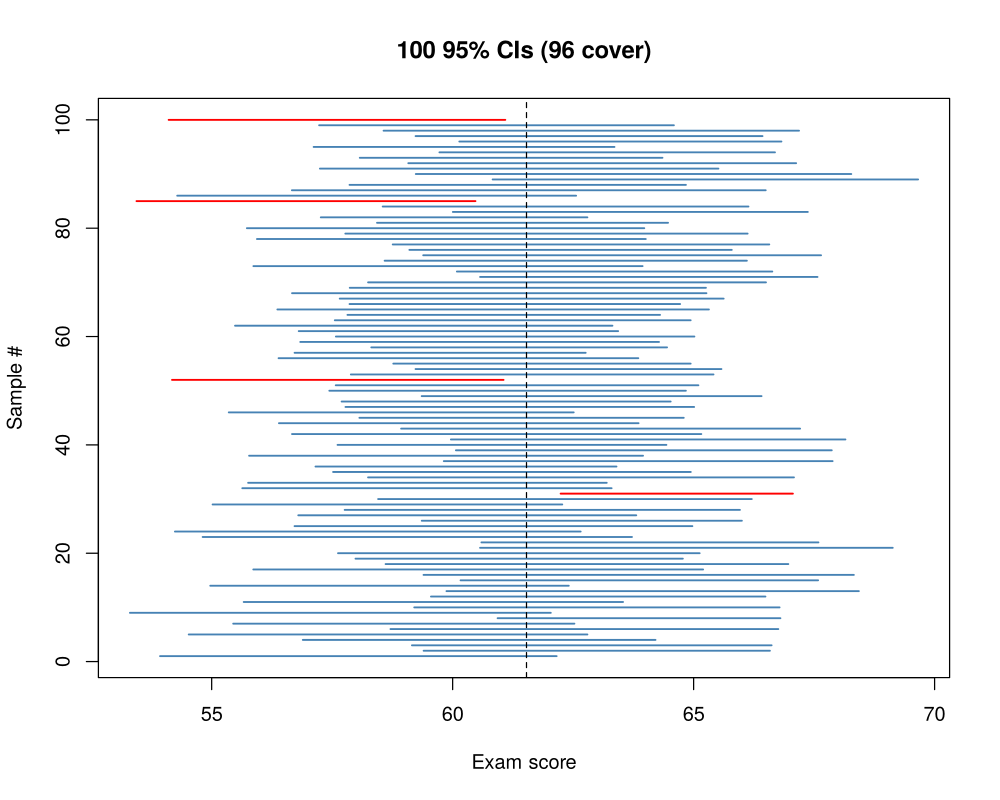

# Topic 5: Confidence intervals

**Course:** BIT 4131 Statistical Computing and Reporting

## 1. Theoretical explanation
A confidence interval gives a range of plausible values for a population parameter. A 95% CI means that if the sampling were repeated many times, about 95% of such intervals would contain the true value. It quantifies uncertainty around a point estimate.

## 2. Mathematical formulation
- Mean (σ unknown): $\bar x\pm t_{\alpha/2,\,n-1}\frac{s}{\sqrt n}$
- Proportion (Wilson) is preferred to Wald $\hat p\pm z\sqrt{\hat p(1-\hat p)/n}$ for small n or extreme p
- Difference in means (Welch): $(\bar x_1-\bar x_2)\pm t\sqrt{\frac{s_1^2}{n_1}+\frac{s_2^2}{n_2}}$

## 3. Worked example
Hand-checkable example (full code in the scripts below).

```text
WORKED EXAMPLE: n=25, mean=50, s=10, 95% CI
SE = s/sqrt(n) = 2.00;  t(0.975, 24) = 2.0639
Margin = 4.128;  CI = (45.87, 54.13)
```

## 4. Dataset analysis and implementation
| Language | Script | Console output |
|---|---|---|
| Python | [`python/analysis.py`](python/analysis.py) | [`outputs/results_python.txt`](outputs/results_python.txt) |
| R | [`r/analysis.R`](r/analysis.R) | [`outputs/results_r.txt`](outputs/results_r.txt) |

Datasets are in [`/data`](../../data) (reproducible synthetic data generated by `data/generate_datasets.py`, seed 4131).

## 5. Expected statistical output
See the two `results_*.txt` files above for the complete printed output (tables, test statistics, p-values, estimates).

## 6. Interpretation and visualisation
- We are 95% confident the true mean exam score lies between 60.4 and 62.7.
- 'Confidence' describes the method: about 95 of every 100 such intervals capture the true mean.
- The interval for method C - A excludes 0, so C genuinely outperforms A.
- Raising confidence from 90% to 99% widens the interval: more certainty costs precision.

### Figures
Files prefixed `py_` come from Python, `r_` from R.




