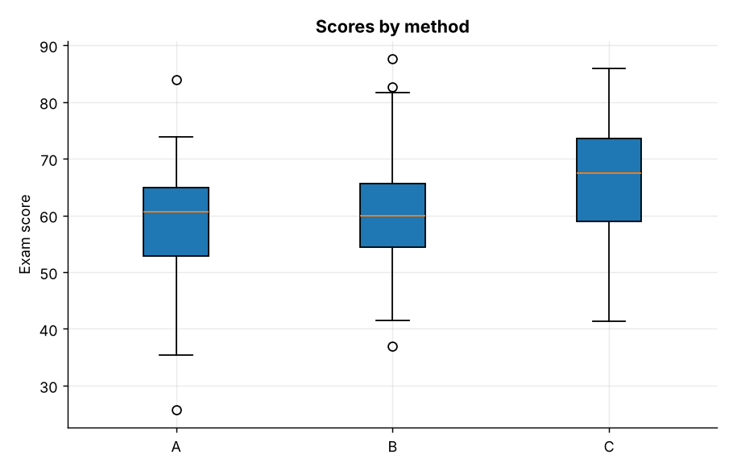
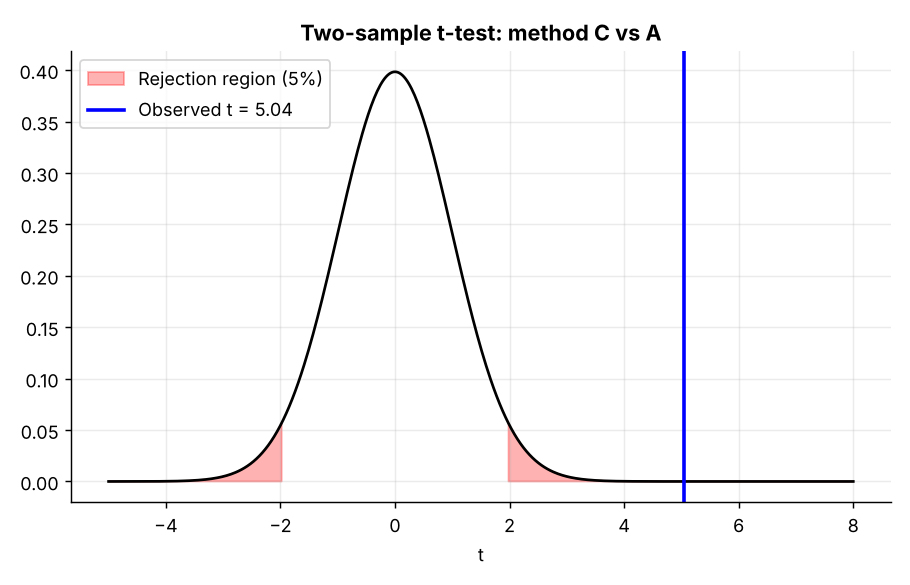
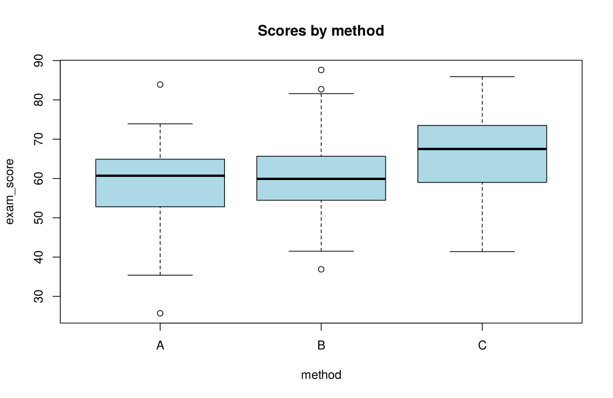
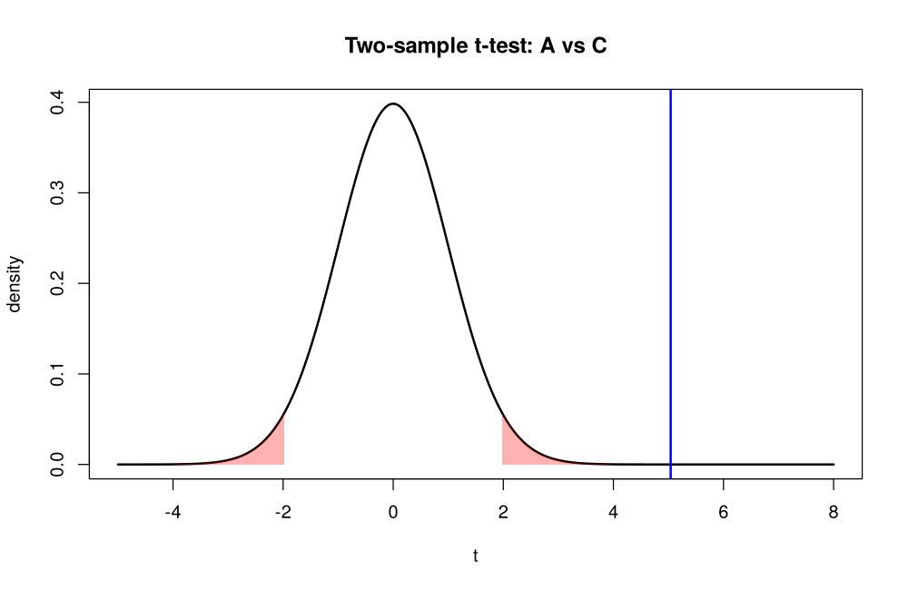

# Topic 6: Hypothesis testing

**Course:** BIT 4131 Statistical Computing and Reporting

## 1. Theoretical explanation
A hypothesis test weighs evidence against a null hypothesis H0. The p-value is the probability of data at least as extreme as observed if H0 were true; if p < α (usually 0.05) we reject H0. Type I error = rejecting a true H0 (probability α); Type II error = failing to reject a false H0.

## 2. Mathematical formulation
- One-sample t: $t=\frac{\bar x-\mu_0}{s/\sqrt n}$, df $=n-1$
- Welch two-sample t: $t=\frac{\bar x_1-\bar x_2}{\sqrt{s_1^2/n_1+s_2^2/n_2}}$
- Paired t: one-sample t on differences $d_i$
- One-proportion z: $z=\frac{\hat p-p_0}{\sqrt{p_0(1-p_0)/n}}$

## 3. Worked example
Hand-checkable example (full code in the scripts below).

```text
WORKED EXAMPLE: one-sample t-test, H0: mu = 60
t = (63-60)/(9/6) = 2.000, df = 35, two-sided p = 0.0533
p = 0.05331 -> FAIL TO REJECT H0 at alpha = 0.05
```

## 4. Dataset analysis and implementation
| Language | Script | Console output |
|---|---|---|
| Python | [`python/analysis.py`](python/analysis.py) | [`outputs/results_python.txt`](outputs/results_python.txt) |
| R | [`r/analysis.R`](r/analysis.R) | [`outputs/results_r.txt`](outputs/results_r.txt) |

Datasets are in [`/data`](../../data) (reproducible synthetic data generated by `data/generate_datasets.py`, seed 4131).

## 5. Expected statistical output
See the two `results_*.txt` files above for the complete printed output (tables, test statistics, p-values, estimates).

## 6. Interpretation and visualisation
- A p-value is the probability of data this extreme if H0 were true; below 0.05 we reject H0.
- Mean score differs from 60 (p=0.01): significant.
- Method C beats A by 7.8 marks (p=1.2e-06, Cohen's d=0.76): significant and practically large.
- Tutoring raised scores on average (paired p=3.21e-09).
- Statistical significance is not the same as practical importance: report effect size too.

### Figures
Files prefixed `py_` come from Python, `r_` from R.





