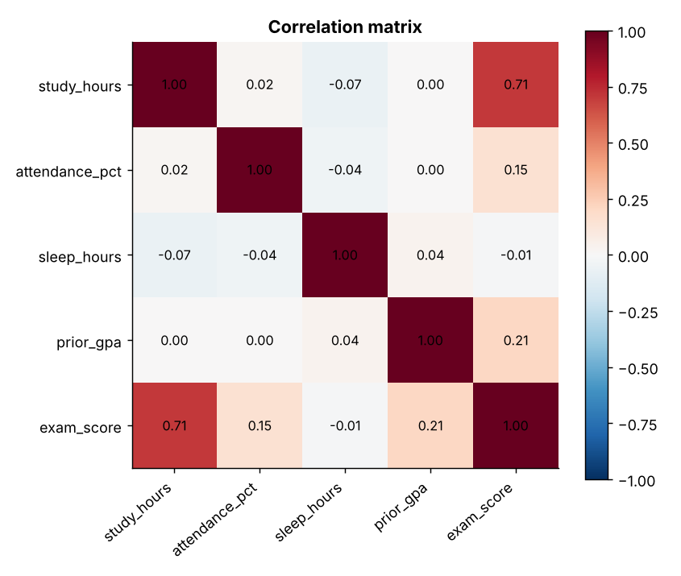
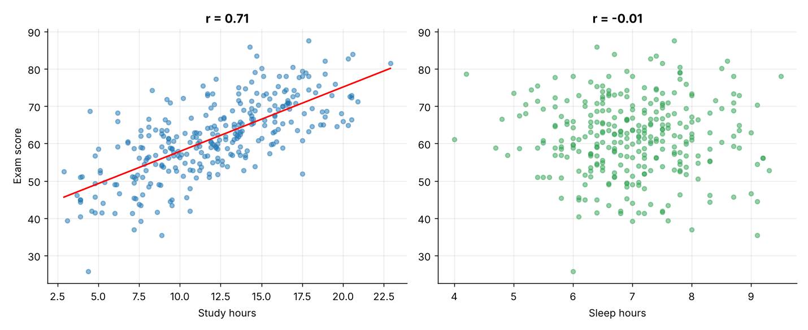
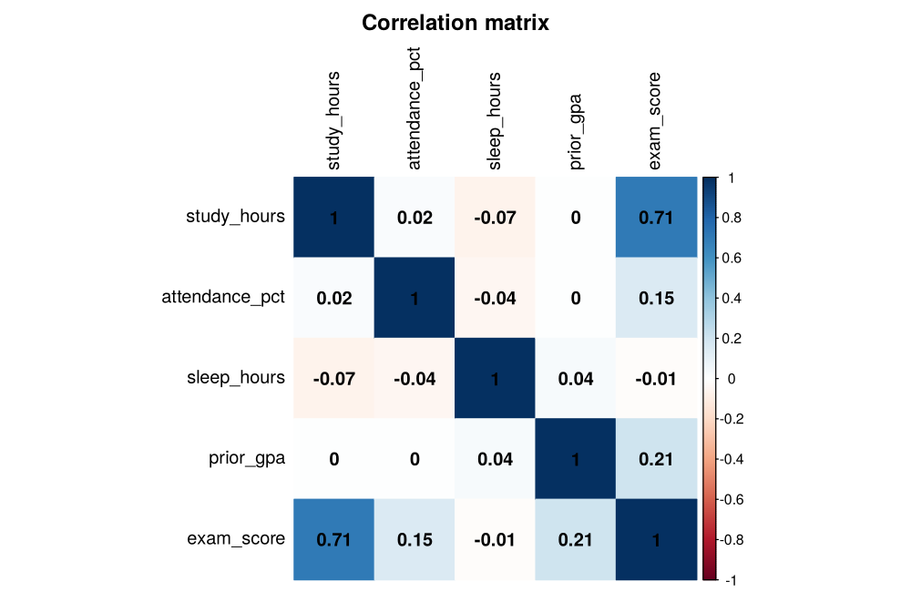
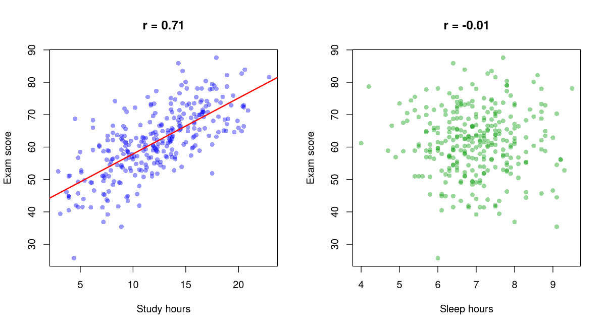

# Topic 7: Correlation and covariance

**Course:** BIT 4131 Statistical Computing and Reporting

## 1. Theoretical explanation
Covariance measures how two variables vary together (sign shows direction, but units make magnitude hard to read). Pearson correlation standardises it to [-1, 1] and measures linear association; Spearman uses ranks and captures monotonic association. Correlation does not imply causation.

## 2. Mathematical formulation
- $\operatorname{cov}(X,Y)=\frac{1}{n-1}\sum (x_i-\bar x)(y_i-\bar y)$
- $r=\frac{\operatorname{cov}(X,Y)}{s_Xs_Y}$
- Test: $t=r\sqrt{\frac{n-2}{1-r^2}}$, df $=n-2$

## 3. Worked example
Hand-checkable example (full code in the scripts below).

```text
WORKED EXAMPLE: x=[1,2,3,4,5], y=[2,4,5,4,5]
x-bar = 3.0, y-bar = 4.0
cov(x,y) = sum((x-xbar)(y-ybar))/(n-1) = 6/4 = 1.5
r = cov/(sx*sy) = 0.7746   (numpy check: 0.7746)
```

## 4. Dataset analysis and implementation
| Language | Script | Console output |
|---|---|---|
| Python | [`python/analysis.py`](python/analysis.py) | [`outputs/results_python.txt`](outputs/results_python.txt) |
| R | [`r/analysis.R`](r/analysis.R) | [`outputs/results_r.txt`](outputs/results_r.txt) |

Datasets are in [`/data`](../../data) (reproducible synthetic data generated by `data/generate_datasets.py`, seed 4131).

## 5. Expected statistical output
See the two `results_*.txt` files above for the complete printed output (tables, test statistics, p-values, estimates).

## 6. Interpretation and visualisation
- Strongest linear link with exam score: study_hours (r = +0.71, p = 5.4e-47).
- Positive r: both rise together. |r| near 1 is strong; near 0 means no linear relationship.
- Covariance depends on units (hard to compare); correlation is the unit-free version in [-1, 1].
- Correlation measures association, not causation: study time may proxy for motivation.

### Figures
Files prefixed `py_` come from Python, `r_` from R.





