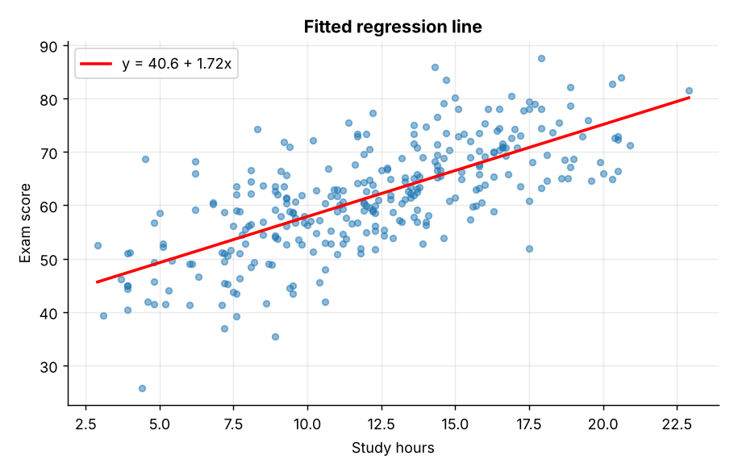
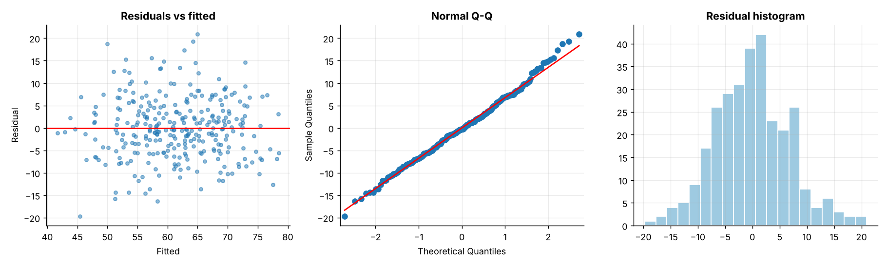
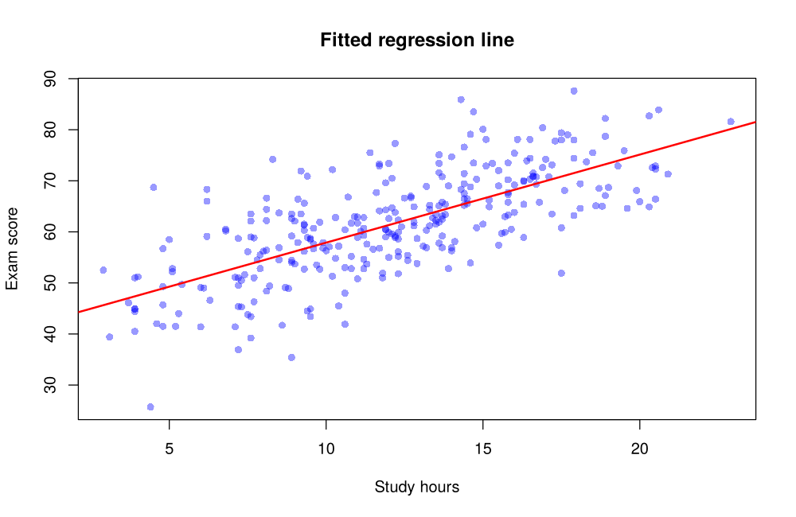
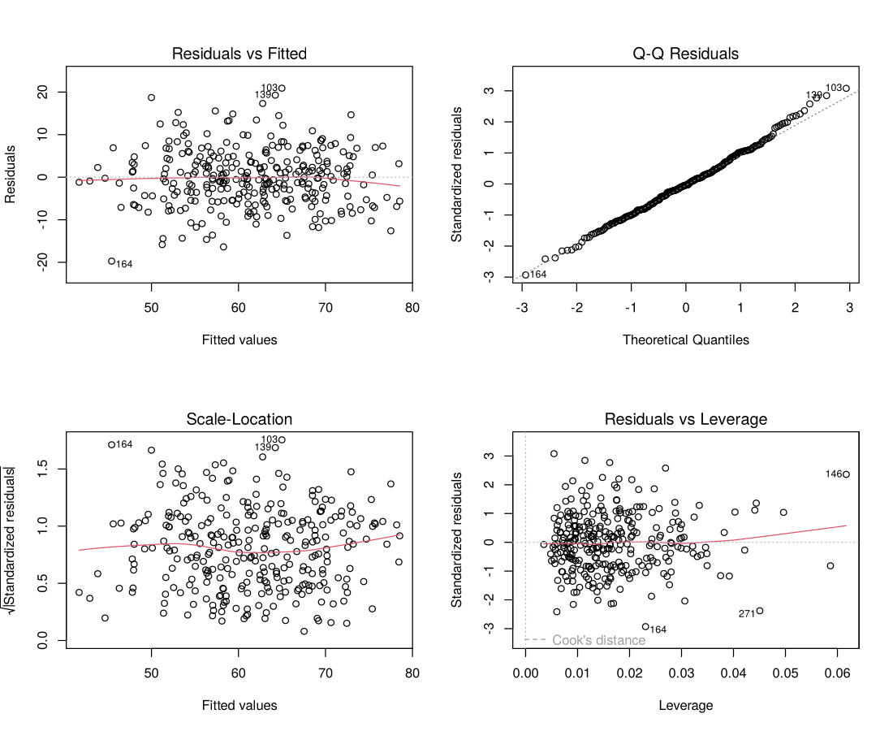

# Topic 8: Linear regression and least squares

**Course:** BIT 4131 Statistical Computing and Reporting

## 1. Theoretical explanation
Linear regression models a response as a linear function of predictors. Ordinary least squares chooses the coefficients that minimise the sum of squared residuals. R² is the share of variance explained; residual plots check linearity, constant variance and normality.

## 2. Mathematical formulation
- Model: $y=\beta_0+\beta_1x_1+\dots+\beta_px_p+\varepsilon$
- Simple: $b_1=\frac{S_{xy}}{S_{xx}}$, $b_0=\bar y-b_1\bar x$
- Matrix form: $\hat\beta=(X^\top X)^{-1}X^\top y$
- $R^2=1-\frac{SSE}{SST}$

## 3. Worked example
Hand-checkable example (full code in the scripts below).

```text
WORKED EXAMPLE: x=[1,2,3,4,5], y=[2,4,5,4,5]
b1 = Sxy/Sxx = 6/10 = 0.60;  b0 = ybar - b1*xbar = 4 - 0.6*3 = 2.20
y-hat = 2.2 + 0.6x
Normal equations (X'X)^-1 X'y = [2.2 0.6]
```

## 4. Dataset analysis and implementation
| Language | Script | Console output |
|---|---|---|
| Python | [`python/analysis.py`](python/analysis.py) | [`outputs/results_python.txt`](outputs/results_python.txt) |
| R | [`r/analysis.R`](r/analysis.R) | [`outputs/results_r.txt`](outputs/results_r.txt) |

Datasets are in [`/data`](../../data) (reproducible synthetic data generated by `data/generate_datasets.py`, seed 4131).

## 5. Expected statistical output
See the two `results_*.txt` files above for the complete printed output (tables, test statistics, p-values, estimates).

## 6. Interpretation and visualisation
- Model explains 56% of variation in exam scores (adj R2 = 0.56).
- Each extra study hour adds about 1.72 marks, holding other variables fixed.
- Significant predictors (p < 0.05): study_hours, attendance_pct, prior_gpa.
- Residuals are approximately normal and show no strong pattern: assumptions look reasonable.

### Figures
Files prefixed `py_` come from Python, `r_` from R.





