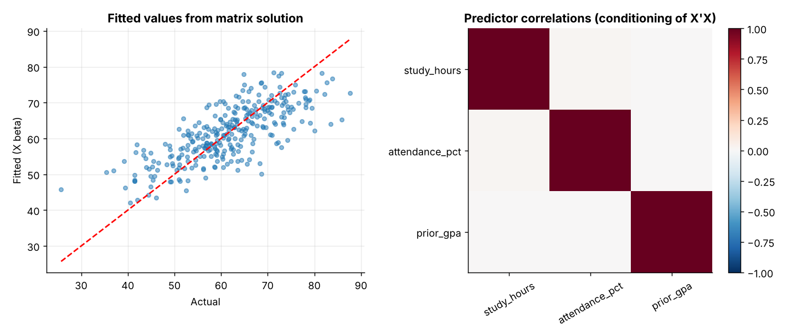
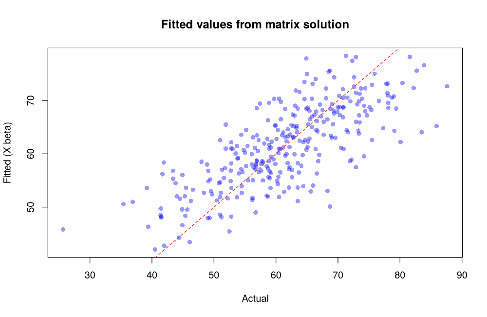

# Topic 9: Matrix algebra in statistics

**Course:** BIT 4131 Statistical Computing and Reporting

## 1. Theoretical explanation
Statistics is written in matrices: data tables are matrices, covariance is a matrix and regression solves a linear system. Core operations: addition, multiplication, transpose, determinant, inverse and solving $Ax=b$. A near-zero determinant or huge condition number signals an unstable system.

## 2. Mathematical formulation
- $(AB)^\top=B^\top A^\top$, $AA^{-1}=I$
- $2\times2$ determinant: $ad-bc$
- Solve $Ax=b\Rightarrow x=A^{-1}b$ (use `solve`, not an explicit inverse)
- Normal equations: $X^\top X\beta=X^\top y$

## 3. Worked example
Hand-checkable example (full code in the scripts below).

```text
WORKED EXAMPLE: A=[[2,1],[1,3]], B=[[1,2],[0,1]]
A + B =
 [[3. 3.]
 [1. 4.]]
A @ B =
 [[2. 5.]
 [1. 5.]]
B @ A =
 [[4. 7.]
 [1. 3.]] 
(matrix multiplication is NOT commutative)
A transpose =
 [[2. 1.]
 [1. 3.]]
det(A) = 2*3 - 1*1 = 5.0
A inverse = (1/5)[[3,-1],[-1,2]] =
 [[ 0.6 -0.2]
 [-0.2  0.4]]
A @ inv(A) =
 [[ 1.  0.]
 [-0.  1.]]
```

## 4. Dataset analysis and implementation
| Language | Script | Console output |
|---|---|---|
| Python | [`python/analysis.py`](python/analysis.py) | [`outputs/results_python.txt`](outputs/results_python.txt) |
| R | [`r/analysis.R`](r/analysis.R) | [`outputs/results_r.txt`](outputs/results_r.txt) |

Datasets are in [`/data`](../../data) (reproducible synthetic data generated by `data/generate_datasets.py`, seed 4131).

## 5. Expected statistical output
See the two `results_*.txt` files above for the complete printed output (tables, test statistics, p-values, estimates).

## 6. Interpretation and visualisation
- Matrix algebra turns a regression with many variables into one equation: beta = (X'X)^-1 X'y.
- A is invertible because det(A) = 5 != 0, so the linear system has a unique solution.
- Trace of the hat matrix equals the parameter count (4); H projects y onto the fitted values.
- A large condition number would signal near-collinear predictors; QR gives a stabler solution.

### Figures
Files prefixed `py_` come from Python, `r_` from R.



