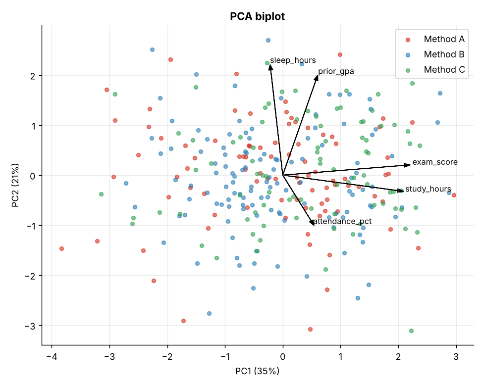
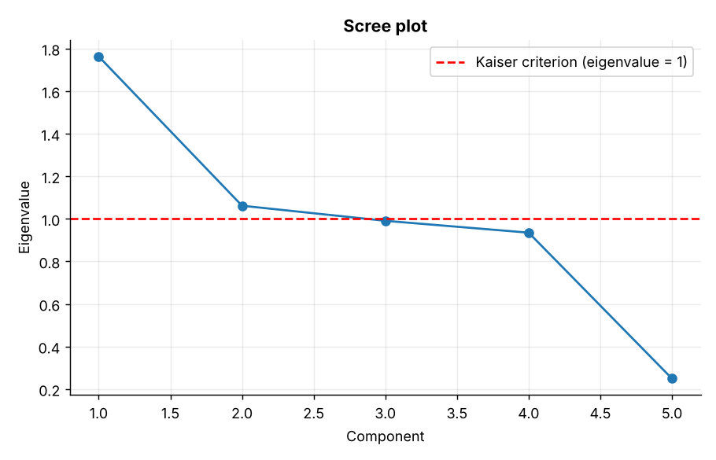
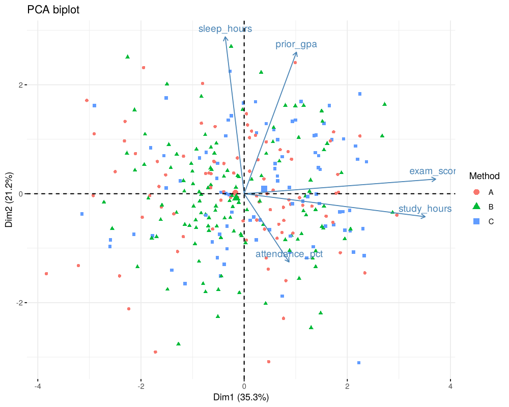
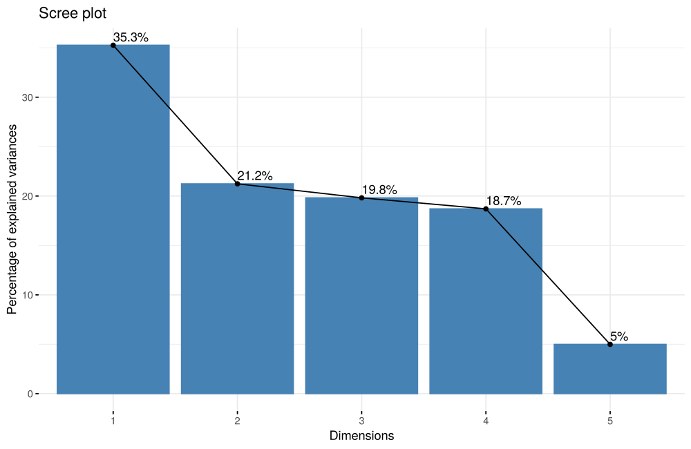

# Topic 10: Eigenvalues, eigenvectors and PCA

**Course:** BIT 4131 Statistical Computing and Reporting

## 1. Theoretical explanation
An eigenvector of a matrix keeps its direction under the transformation and is only scaled by its eigenvalue. PCA applies this to the covariance/correlation matrix: eigenvectors are the principal components (directions of greatest variance) and eigenvalues give the variance each carries.

## 2. Mathematical formulation
- $Av=\lambda v$; solve $\det(A-\lambda I)=0$
- Explained variance ratio of component $k$: $\lambda_k/\sum_j\lambda_j$
- Scores: $Z=X_{std}V$
- Kaiser rule: keep components with $\lambda>1$ on the correlation matrix

## 3. Worked example
Hand-checkable example (full code in the scripts below).

```text
WORKED EXAMPLE: A = [[2,1],[1,2]]
Characteristic equation: (2-L)^2 - 1 = 0  ->  L = 1 and L = 3
Eigenvalues (numpy): [1. 3.]
Eigenvectors (columns):
 [[-0.7071  0.7071]
 [ 0.7071  0.7071]]
Check A v = L v for L=3: [2.1213 2.1213] = [2.1213 2.1213]
```

## 4. Dataset analysis and implementation
| Language | Script | Console output |
|---|---|---|
| Python | [`python/analysis.py`](python/analysis.py) | [`outputs/results_python.txt`](outputs/results_python.txt) |
| R | [`r/analysis.R`](r/analysis.R) | [`outputs/results_r.txt`](outputs/results_r.txt) |

Datasets are in [`/data`](../../data) (reproducible synthetic data generated by `data/generate_datasets.py`, seed 4131).

## 5. Expected statistical output
See the two `results_*.txt` files above for the complete printed output (tables, test statistics, p-values, estimates).

## 6. Interpretation and visualisation
- 2 component(s) have eigenvalue > 1 (Kaiser rule); the first two explain 56% of variance.
- PC1 is dominated by exam_score and study_hours: a general 'academic effort/achievement' axis.
- Eigenvalues sum to the number of standardised variables; each is the variance captured by its component.
- Keeping the leading components compresses the data while preserving most of the information.

### Figures
Files prefixed `py_` come from Python, `r_` from R.





