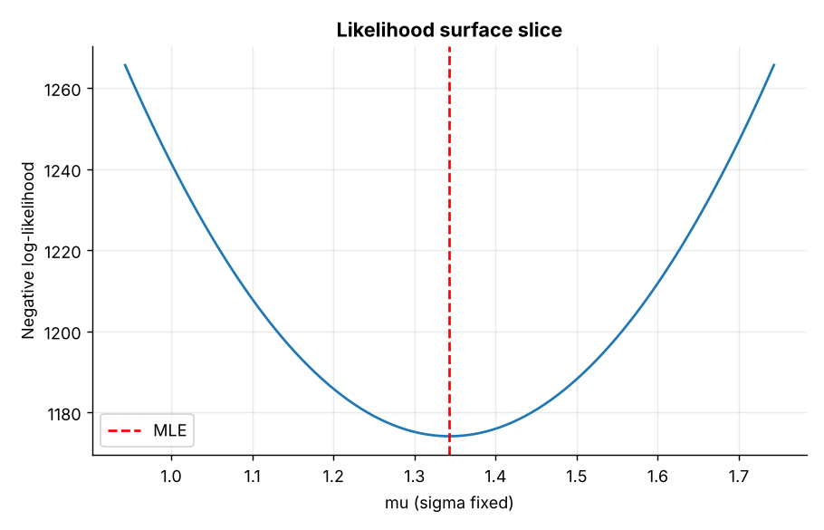
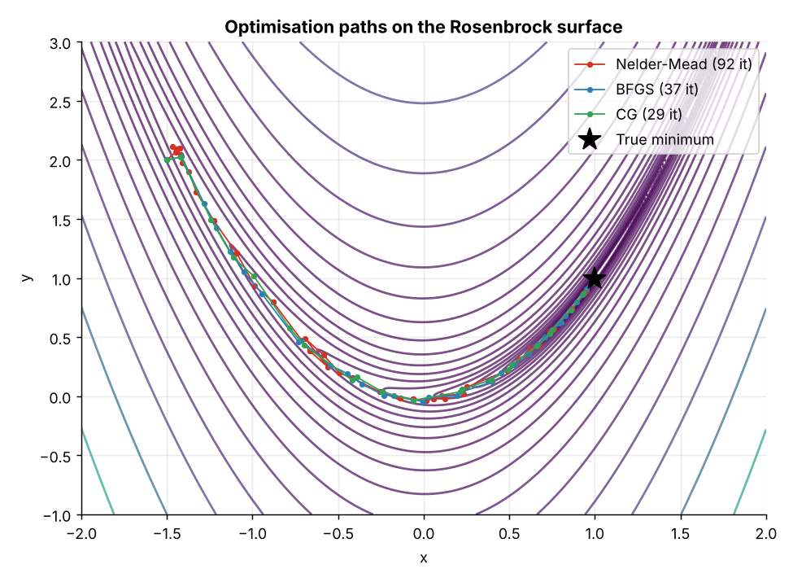
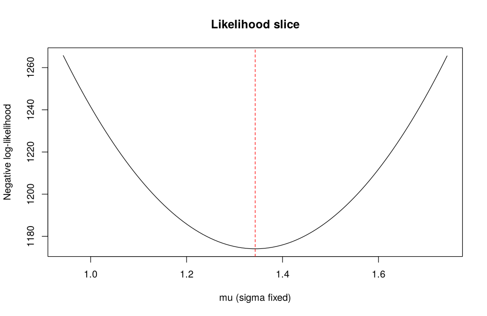
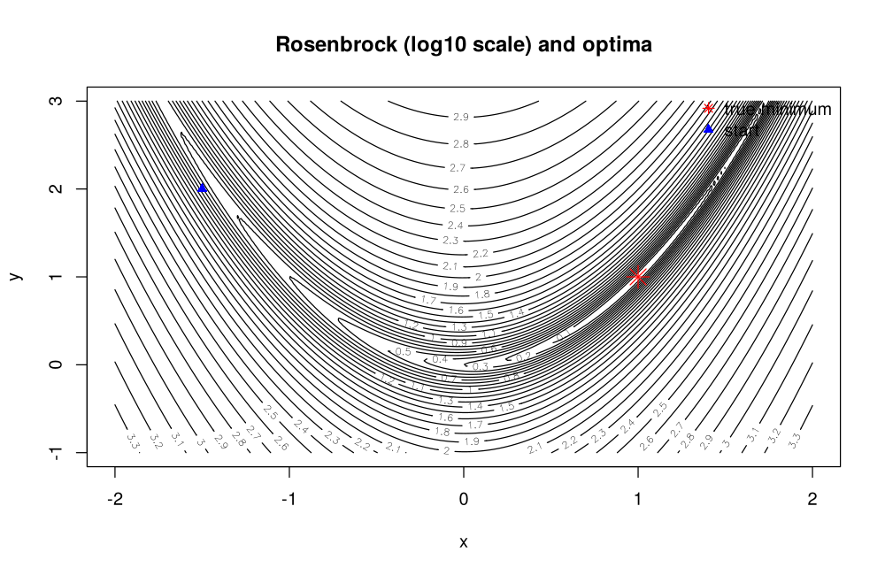

# Topic 11: Numerical optimization

**Course:** BIT 4131 Statistical Computing and Reporting

## 1. Theoretical explanation
Many statistical estimates (MLE, least squares) have no closed form and are found by iterative optimisation. Gradient-based methods (BFGS, CG) use derivatives; Nelder-Mead is derivative-free. Maximising a likelihood is minimising the negative log-likelihood.

## 2. Mathematical formulation
- Minimise $f(\theta)$; optimum satisfies $\nabla f(\theta^*)=0$
- Gradient descent: $\theta_{k+1}=\theta_k-\eta\nabla f(\theta_k)$
- MLE: $\hat\theta=\arg\max\sum\ln f(x_i;\theta)$
- Rosenbrock: $f(x,y)=(1-x)^2+100(y-x^2)^2$

## 3. Worked example
Hand-checkable example (full code in the scripts below).

```text
WORKED EXAMPLE: minimise f(x) = (x - 3)^2 + 2
Analytic: f'(x) = 2(x-3) = 0 -> x* = 3, f(x*) = 2
Numeric : x* = 3.000000, f(x*) = 2.000000, converged = True
```

## 4. Dataset analysis and implementation
| Language | Script | Console output |
|---|---|---|
| Python | [`python/analysis.py`](python/analysis.py) | [`outputs/results_python.txt`](outputs/results_python.txt) |
| R | [`r/analysis.R`](r/analysis.R) | [`outputs/results_r.txt`](outputs/results_r.txt) |

Datasets are in [`/data`](../../data) (reproducible synthetic data generated by `data/generate_datasets.py`, seed 4131).

## 5. Expected statistical output
See the two `results_*.txt` files above for the complete printed output (tables, test statistics, p-values, estimates).

## 6. Interpretation and visualisation
- All three methods reach (1,1). Iterations: Nelder-Mead 93, BFGS 37, CG 29: gradient-based methods need fewer steps than the derivative-free simplex.
- Numerical MLE agrees with the closed-form estimates: optimisation is how MLE is computed when no formula exists.
- The constrained solution allocates more hours to the higher-benefit subject, matching the Lagrange result.

### Figures
Files prefixed `py_` come from Python, `r_` from R.





