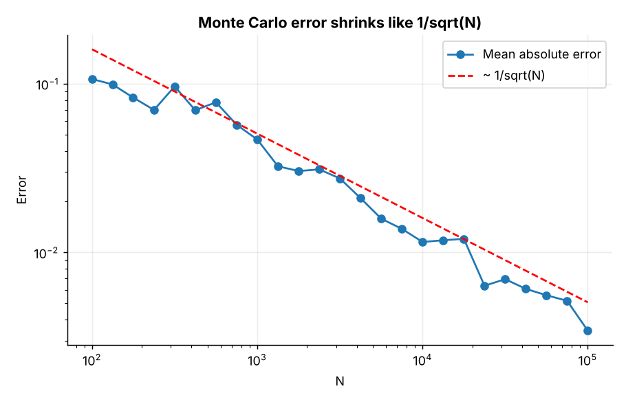
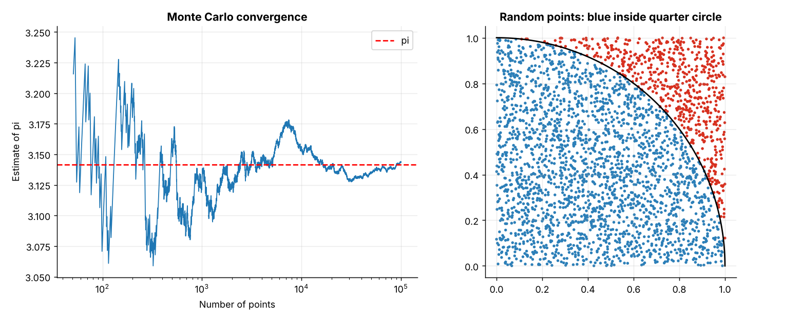
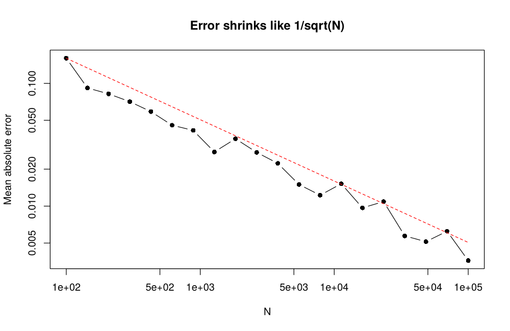
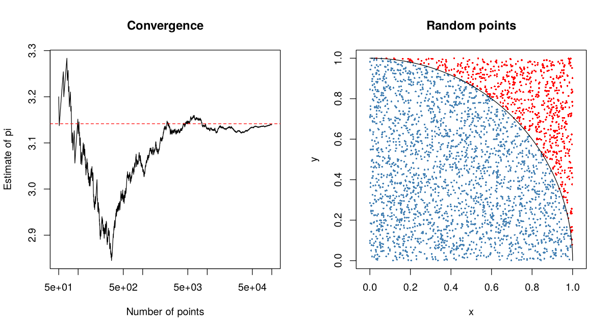

# Topic 12: Random numbers and Monte Carlo methods

**Course:** BIT 4131 Statistical Computing and Reporting

## 1. Theoretical explanation
Monte Carlo methods use random sampling to approximate quantities that are hard to compute exactly. Pseudo-random numbers are reproducible via a seed. By the law of large numbers the estimate converges, with error shrinking like $1/\sqrt n$.

## 2. Mathematical formulation
- Integral: $\int_a^b g(x)dx\approx\frac{b-a}{n}\sum g(U_i)$, $U_i\sim U(a,b)$
- $\pi\approx4\cdot\frac{\#\text{points inside quarter circle}}{n}$
- Inverse transform: $X=F^{-1}(U)$, e.g. Exponential $X=-\ln(1-U)/\lambda$
- MC standard error $=s/\sqrt n$

## 3. Worked example
Hand-checkable example (full code in the scripts below).

```text
WORKED EXAMPLE: estimate pi (area of quarter circle = pi/4)
pi-hat = 4 * 78593/100000 = 3.14372  (true 3.14159); MC standard error = 0.00519
```

## 4. Dataset analysis and implementation
| Language | Script | Console output |
|---|---|---|
| Python | [`python/analysis.py`](python/analysis.py) | [`outputs/results_python.txt`](outputs/results_python.txt) |
| R | [`r/analysis.R`](r/analysis.R) | [`outputs/results_r.txt`](outputs/results_r.txt) |

Datasets are in [`/data`](../../data) (reproducible synthetic data generated by `data/generate_datasets.py`, seed 4131).

## 5. Expected statistical output
See the two `results_*.txt` files above for the complete printed output (tables, test statistics, p-values, estimates).

## 6. Interpretation and visualisation
- With 100,000 random points pi is estimated as 3.1437, within 0.0021 of the truth.
- Inverse-transform sampling turns uniform random numbers into any distribution with an invertible CDF.
- Error falls like 1/sqrt(N): 100x more simulations buy only 10x more accuracy.
- The simulated failure probability agrees closely with the exact binomial value, and the MC integral with quadrature.

### Figures
Files prefixed `py_` come from Python, `r_` from R.





