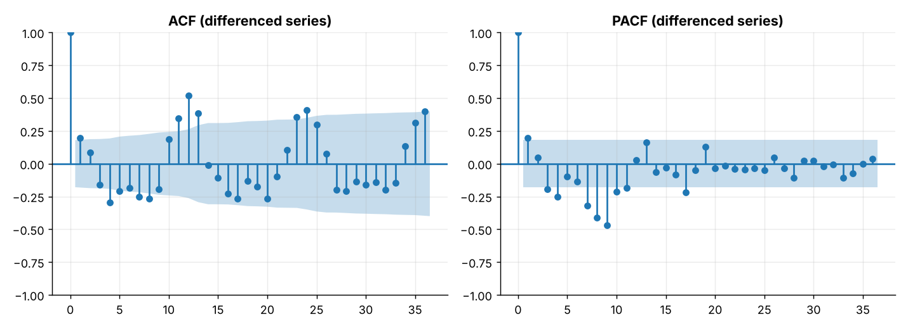
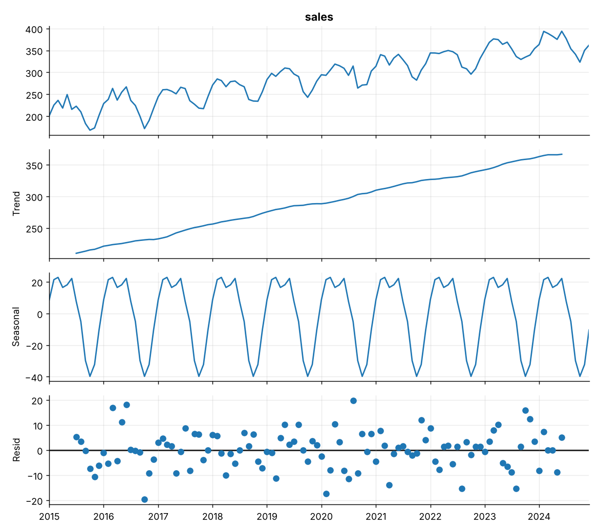
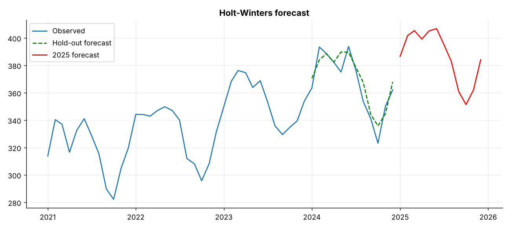
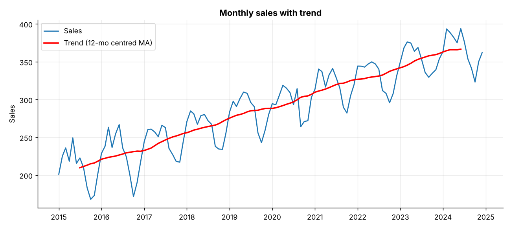
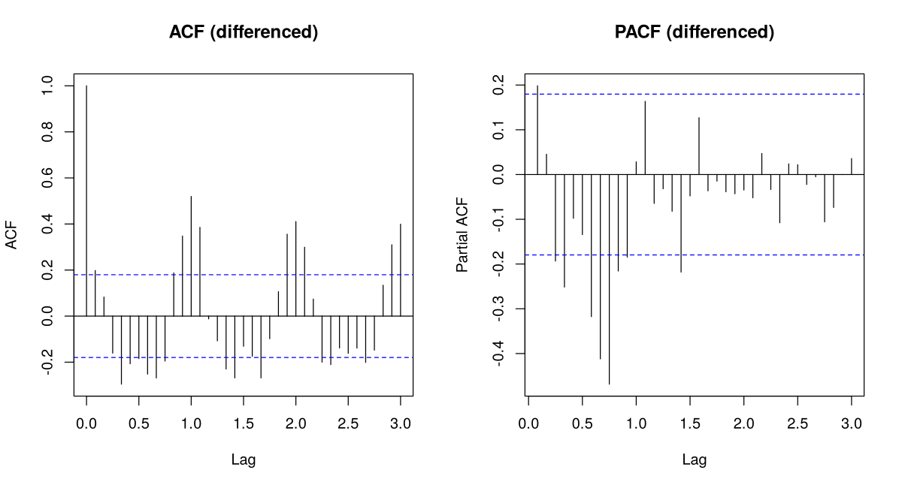
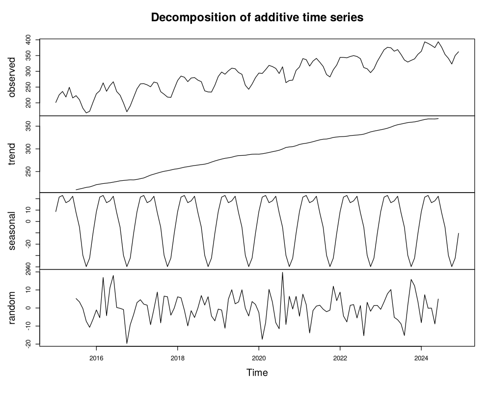
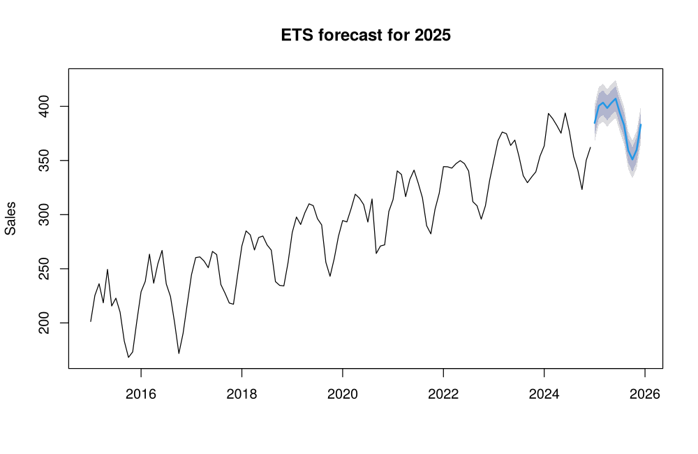
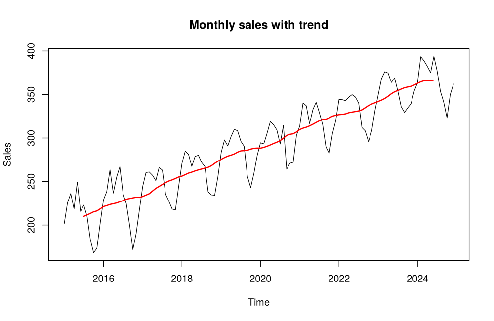

# Topic 13: Time-series analysis

**Course:** BIT 4131 Statistical Computing and Reporting

## 1. Theoretical explanation
A time series is data ordered in time. It is decomposed into trend, seasonality and noise. Autocorrelation shows dependence on past values; stationarity (tested by ADF) is required by many models. Holt-Winters exponential smoothing forecasts trend and seasonality.

## 2. Mathematical formulation
- Additive model: $y_t=T_t+S_t+\varepsilon_t$
- ACF: $\rho_k=\frac{\operatorname{cov}(y_t,y_{t-k})}{\operatorname{var}(y_t)}$
- Moving average: $\frac1m\sum_{i}y_{t-i}$
- Accuracy: MAE, RMSE, MAPE $=\frac{100}{n}\sum|\frac{y_t-\hat y_t}{y_t}|$

## 3. Worked example
Hand-checkable example (full code in the scripts below).

```text
WORKED EXAMPLE: 3-point moving average of [10, 12, 14, 13, 15]
MA(3) = [nan, nan, 12.0, 13.0, 14.0]  -> (10+12+14)/3 = 12, (12+14+13)/3 = 13, (14+13+15)/3 = 14
```

## 4. Dataset analysis and implementation
| Language | Script | Console output |
|---|---|---|
| Python | [`python/analysis.py`](python/analysis.py) | [`outputs/results_python.txt`](outputs/results_python.txt) |
| R | [`r/analysis.R`](r/analysis.R) | [`outputs/results_r.txt`](outputs/results_r.txt) |

Datasets are in [`/data`](../../data) (reproducible synthetic data generated by `data/generate_datasets.py`, seed 4131).

## 5. Expected statistical output
See the two `results_*.txt` files above for the complete printed output (tables, test statistics, p-values, estimates).

## 6. Interpretation and visualisation
- Sales trend upward by about 17 units a year.
- A clear 12-month seasonal cycle: highest around March, lowest around October (range 63).
- The raw series is non-stationary (trend); differencing removes it, which ARIMA-type models require.
- Holt-Winters predicts the held-out year with MAPE of 1.8%, and a 2025 forecast continues trend + seasonality.

### Figures
Files prefixed `py_` come from Python, `r_` from R.









