# Topic 14: Statistical data visualization

**Course:** BIT 4131 Statistical Computing and Reporting

## 1. Theoretical explanation
The chart must match the data: histogram/density for one numeric variable, boxplot/violin for distributions by group, scatter for two numeric variables, bar for counts, line for time. Honest axes and clear labels prevent misleading graphics.

## 2. Mathematical formulation
- Histogram bins (Freedman-Diaconis): $h=2\,\frac{IQR}{n^{1/3}}$
- Boxplot: whiskers to $1.5\,IQR$ beyond the quartiles
- Kernel density: $\hat f(x)=\frac{1}{nh}\sum K\!\left(\frac{x-x_i}{h}\right)$

## 3. Worked example
Hand-checkable example (full code in the scripts below).

```text
WORKED EXAMPLE: choosing the right chart
One numeric variable        -> histogram / density / boxplot
Numeric by category         -> boxplot / violin / bar of means with error bars
Two numeric variables       -> scatter plot (+ regression line)
Numeric over time           -> line graph
Counts of a category        -> bar chart (never a pie chart for many categories)
Many numeric variables      -> correlation heatmap / scatter matrix
```

## 4. Dataset analysis and implementation
| Language | Script | Console output |
|---|---|---|
| Python | [`python/analysis.py`](python/analysis.py) | [`outputs/results_python.txt`](outputs/results_python.txt) |
| R | [`r/analysis.R`](r/analysis.R) | [`outputs/results_r.txt`](outputs/results_r.txt) |

Datasets are in [`/data`](../../data) (reproducible synthetic data generated by `data/generate_datasets.py`, seed 4131).

## 5. Expected statistical output
See the two `results_*.txt` files above for the complete printed output (tables, test statistics, p-values, estimates).

## 6. Interpretation and visualisation
- Histogram shows an approximately bell-shaped score distribution centred near 61.
- Boxplot/violin reveal method C shifts the whole distribution upward while spreads stay similar.
- Scatter shows a clear positive linear relationship between study hours and score.
- The truncated-axis bar chart exaggerates differences between methods: always start bar axes at zero.

### Figures
Files prefixed `py_` come from Python, `r_` from R.

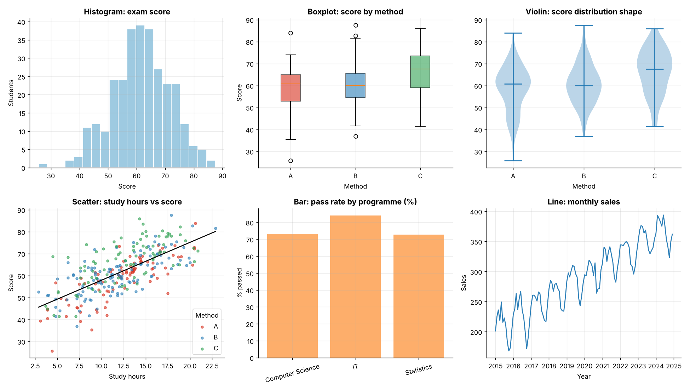
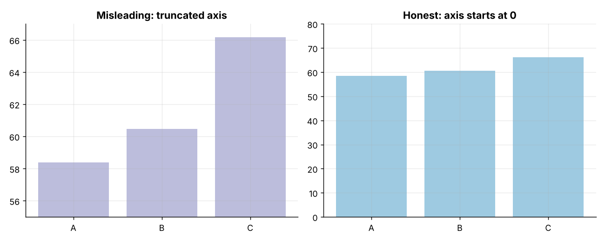
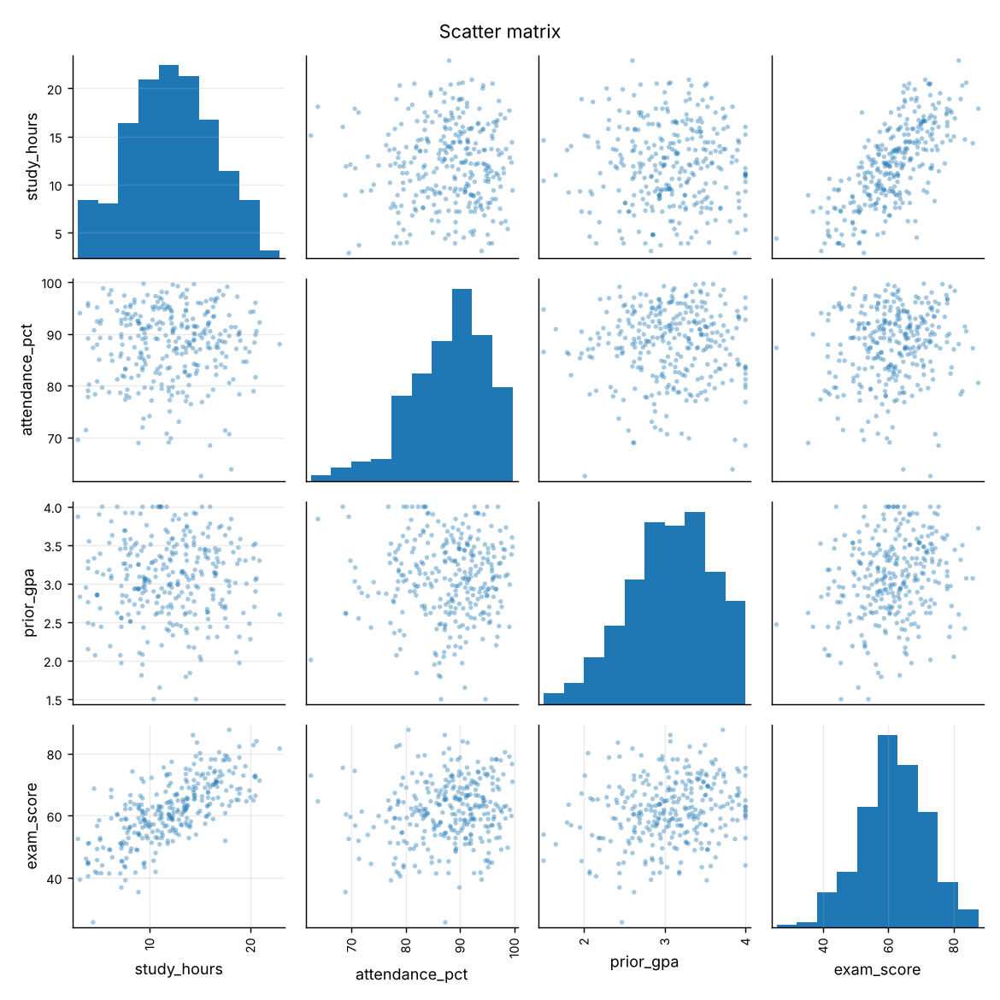
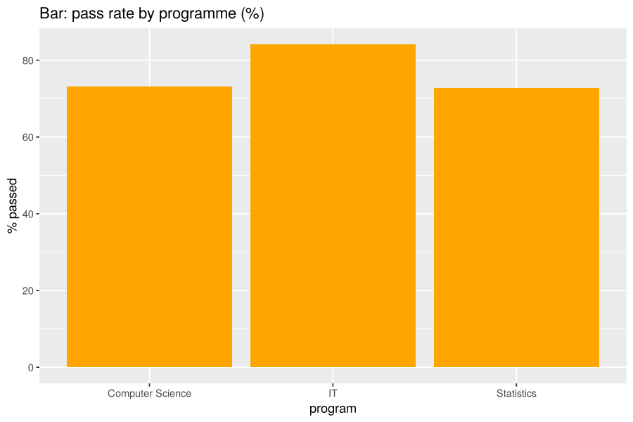
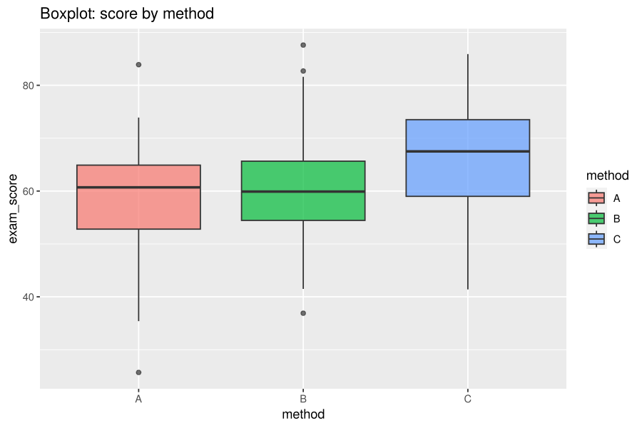
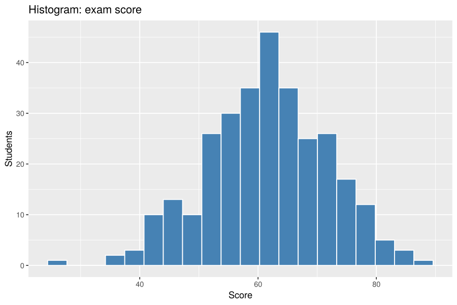
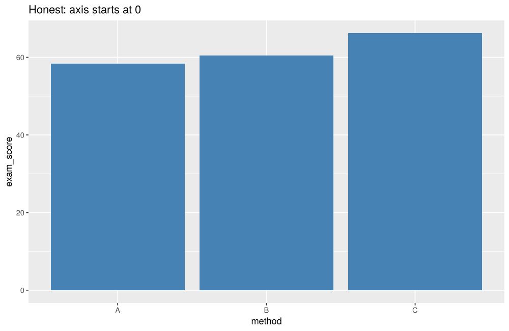
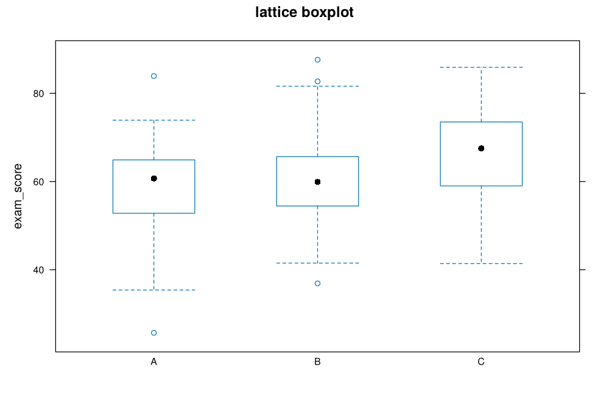
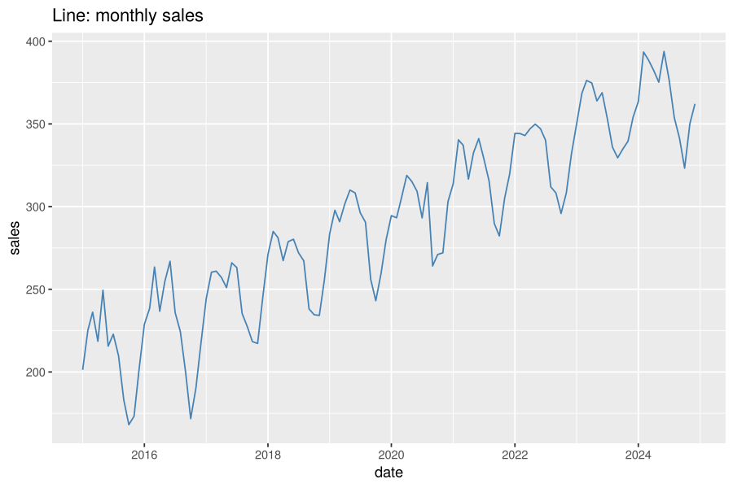
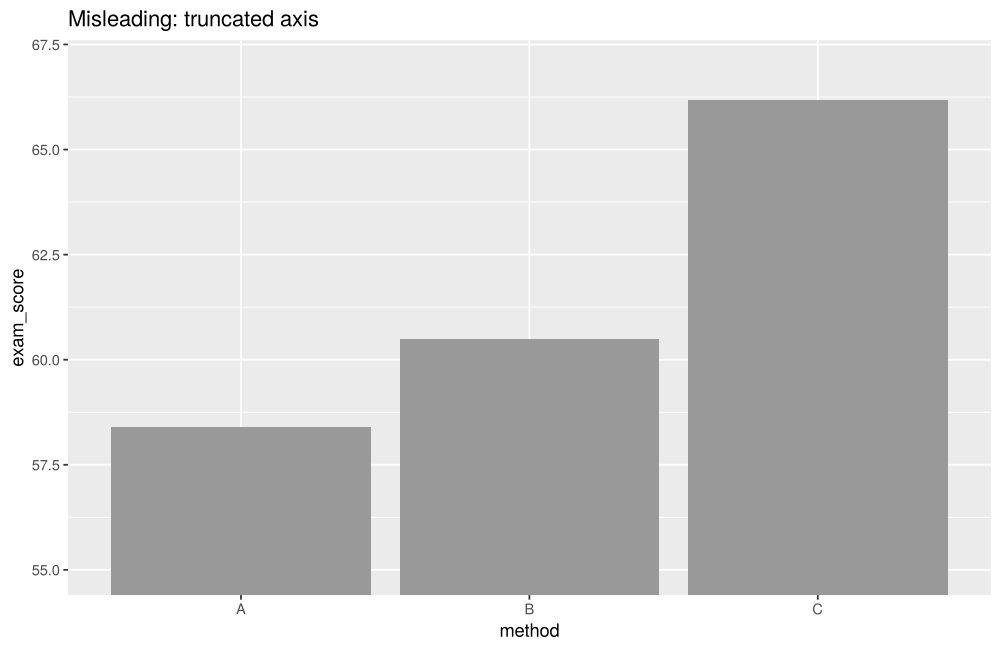
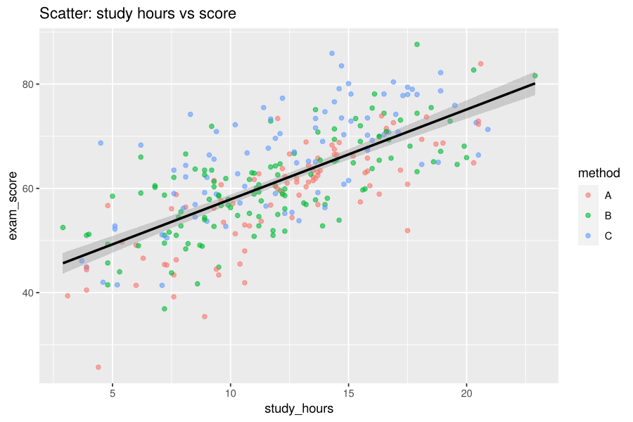
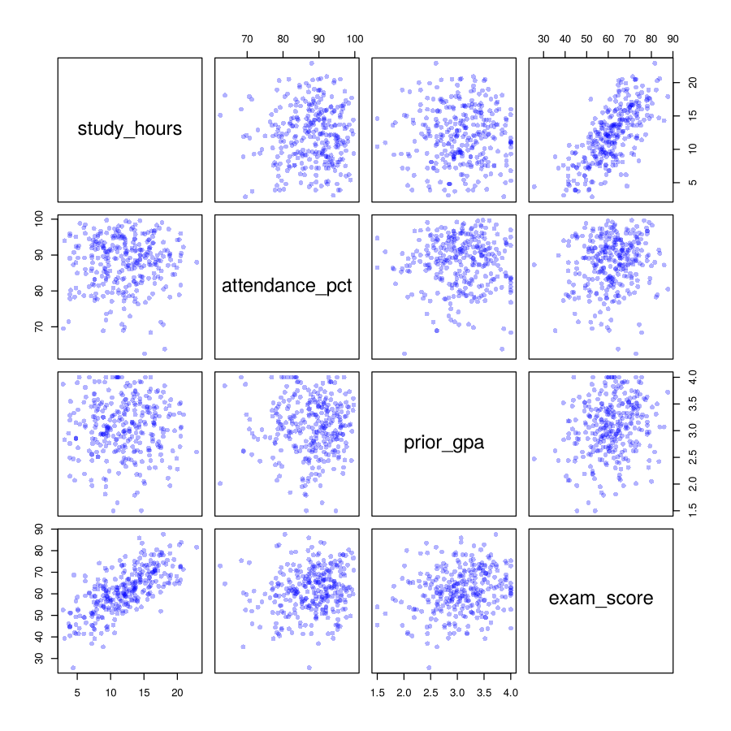
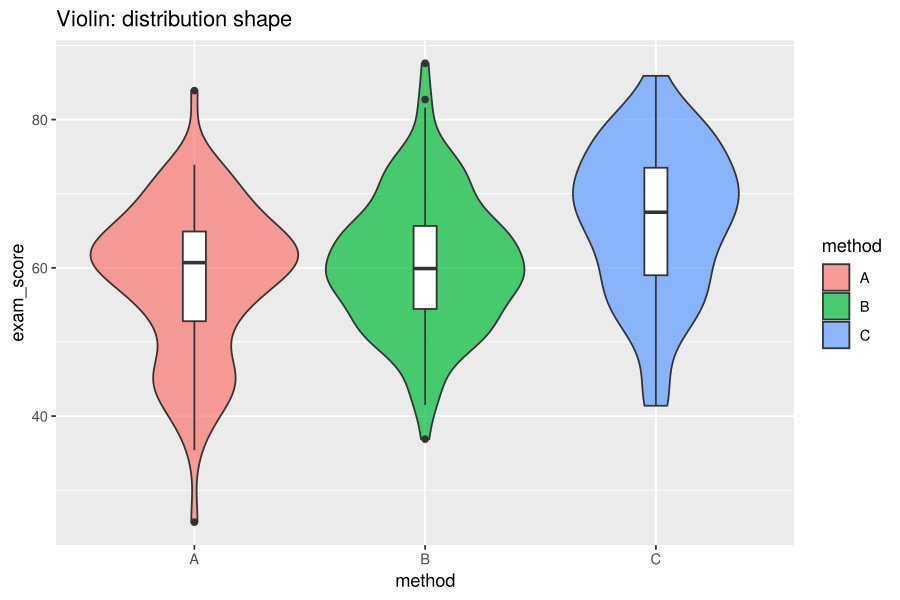
