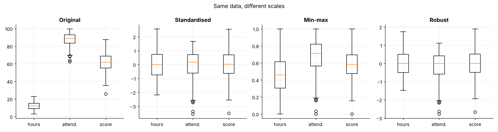
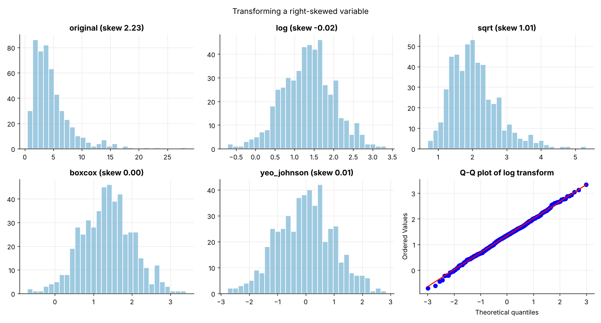
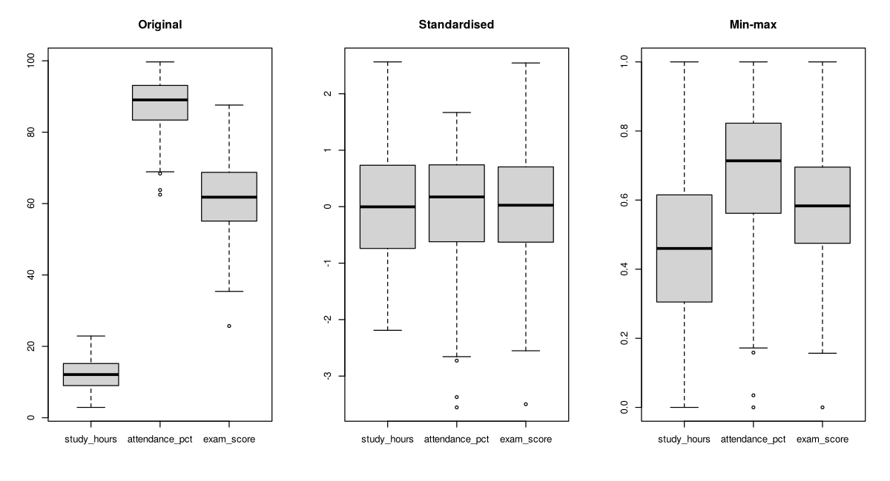
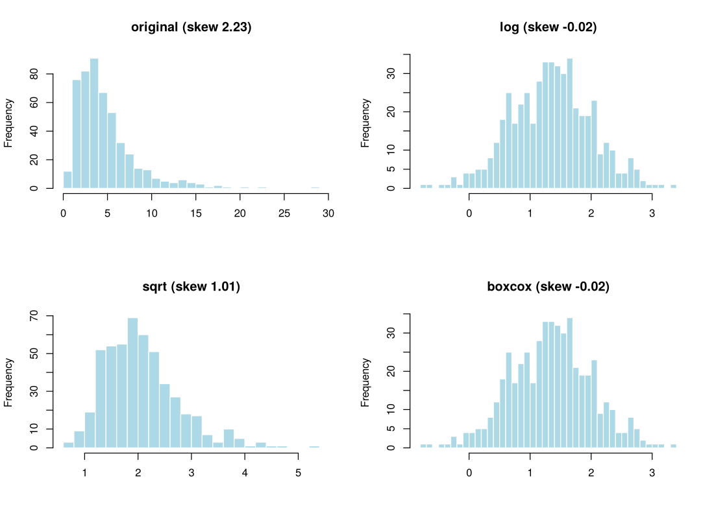

# Topic 15: Data transformation and normalization

**Course:** BIT 4131 Statistical Computing and Reporting

## 1. Theoretical explanation
Transformations reduce skewness (log, square root, Box-Cox). Scaling puts variables on comparable ranges (z-score standardisation, min-max normalisation), which matters for distance-based and gradient methods such as PCA, k-means and regularised models.

## 2. Mathematical formulation
- z-score: $z=\frac{x-\bar x}{s}$
- Min-max: $x'=\frac{x-x_{min}}{x_{max}-x_{min}}$
- Log: $y=\ln x$; Box-Cox: $y=\frac{x^\lambda-1}{\lambda}$ ($\lambda\neq0$), $\ln x$ ($\lambda=0$)

## 3. Worked example
Hand-checkable example (full code in the scripts below).

```text
WORKED EXAMPLE: data = [10, 20, 30, 40, 100]
mean = 40.0, sd = 35.3553
z-score    = [-0.849 -0.566 -0.283  0.     1.697]  (z = (x - mean)/sd)
min-max    = [0.    0.111 0.222 0.333 1.   ]  ((x - min)/(max - min))
log10      = [1.    1.301 1.477 1.602 2.   ]
```

## 4. Dataset analysis and implementation
| Language | Script | Console output |
|---|---|---|
| Python | [`python/analysis.py`](python/analysis.py) | [`outputs/results_python.txt`](outputs/results_python.txt) |
| R | [`r/analysis.R`](r/analysis.R) | [`outputs/results_r.txt`](outputs/results_r.txt) |

Datasets are in [`/data`](../../data) (reproducible synthetic data generated by `data/generate_datasets.py`, seed 4131).

## 5. Expected statistical output
See the two `results_*.txt` files above for the complete printed output (tables, test statistics, p-values, estimates).

## 6. Interpretation and visualisation
- Resolution time has skewness 2.23; the boxcox transform cuts it to 0.00.
- z-scores give mean 0 / SD 1 (compare variables on one scale); min-max maps to [0,1] but is sensitive to outliers.
- Scaling before distance-based methods (k-means, PCA, KNN) stops large-unit variables dominating.
- Always fit scalers on training data only, then apply to test data, to avoid leakage.

### Figures
Files prefixed `py_` come from Python, `r_` from R.





