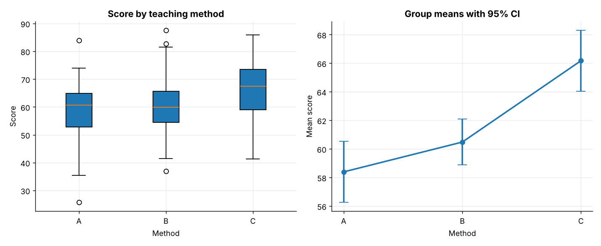
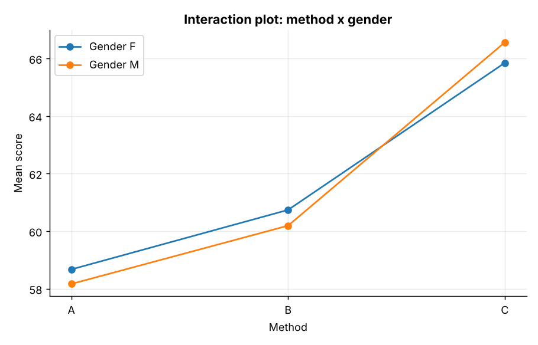
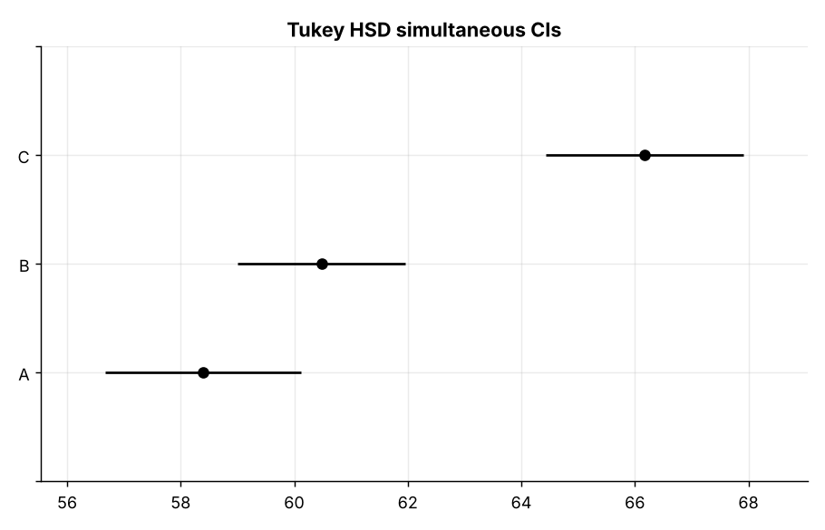
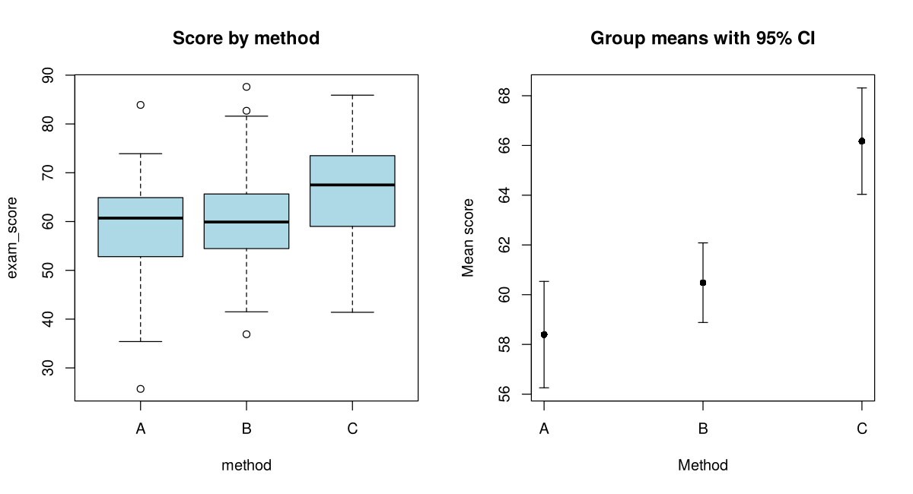
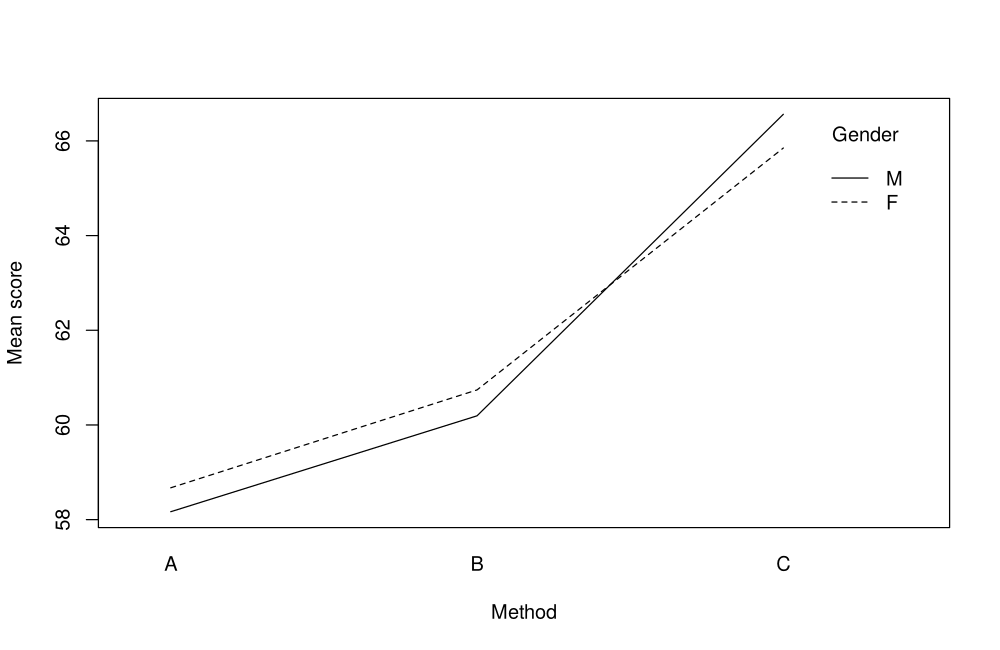
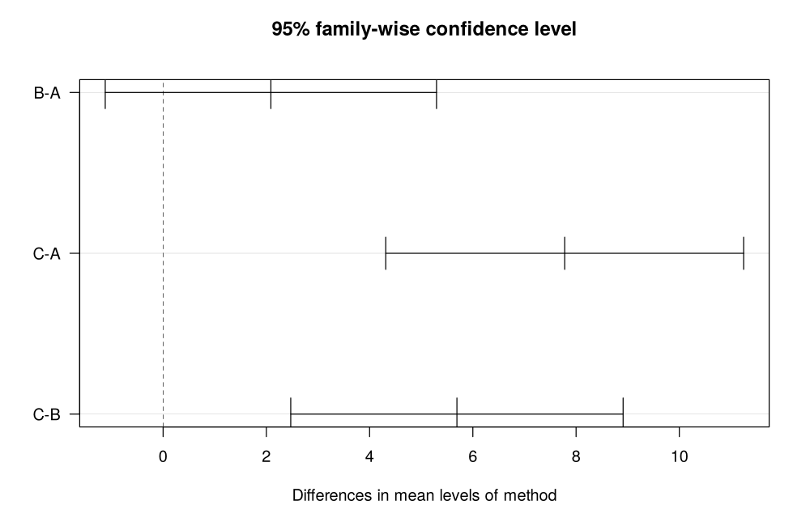

# Topic 16: ANOVA and experimental design

**Course:** BIT 4131 Statistical Computing and Reporting

## 1. Theoretical explanation
One-way ANOVA tests whether three or more group means are equal by comparing between-group to within-group variability. If significant, post-hoc tests (Tukey HSD) locate the differing groups. Two-way ANOVA adds a second factor and an interaction. Assumptions: independence, normal residuals, equal variances.

## 2. Mathematical formulation
- $SST=SSB+SSW$
- $F=\frac{MSB}{MSW}=\frac{SSB/(k-1)}{SSW/(N-k)}$
- Effect size: $\eta^2=SSB/SST$

## 3. Worked example
Hand-checkable example (full code in the scripts below).

```text
WORKED EXAMPLE: groups G1=[5,6,7], G2=[8,9,10], G3=[11,12,13]
Grand mean = 9.0;  SSB = 54.0;  SSW = 6.0
MSB = 27.0;  MSW = 1.0;  F = 27.00;  p = 0.00100
scipy check: F_onewayResult(statistic=np.float64(27.0), pvalue=np.float64(0.0010000000000000002))
```

## 4. Dataset analysis and implementation
| Language | Script | Console output |
|---|---|---|
| Python | [`python/analysis.py`](python/analysis.py) | [`outputs/results_python.txt`](outputs/results_python.txt) |
| R | [`r/analysis.R`](r/analysis.R) | [`outputs/results_r.txt`](outputs/results_r.txt) |

Datasets are in [`/data`](../../data) (reproducible synthetic data generated by `data/generate_datasets.py`, seed 4131).

## 5. Expected statistical output
See the two `results_*.txt` files above for the complete printed output (tables, test statistics, p-values, estimates).

## 6. Interpretation and visualisation
- The F-test (F = 15.2, p = 5.3e-07) rejects H0: at least one method has a different mean.
- Method explains 9% of score variance (eta-squared): a medium effect.
- Tukey HSD identifies which pairs differ: A-C, B-C.
- Interaction method x gender p = 0.884: no evidence the method effect depends on gender.

### Figures
Files prefixed `py_` come from Python, `r_` from R.







