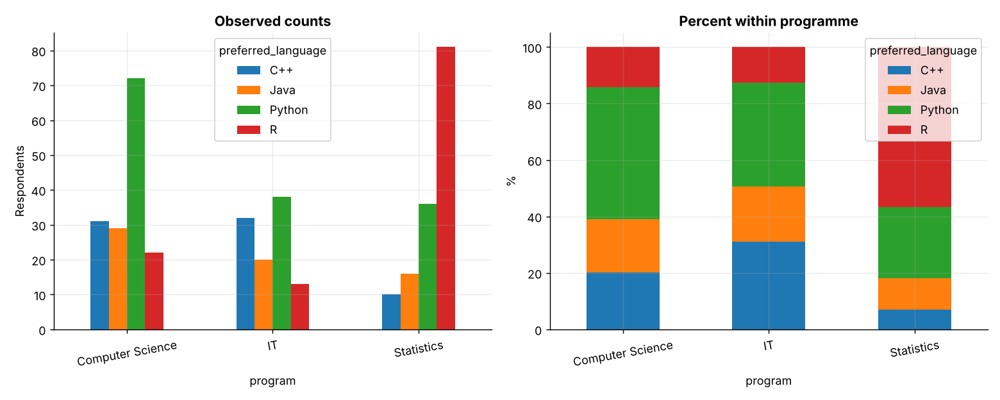
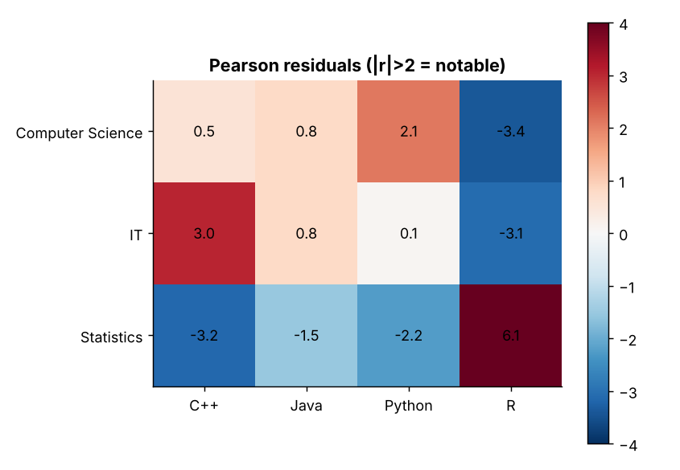
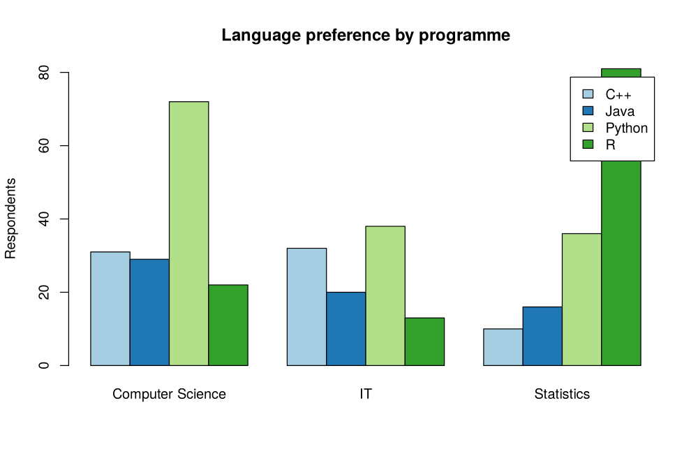
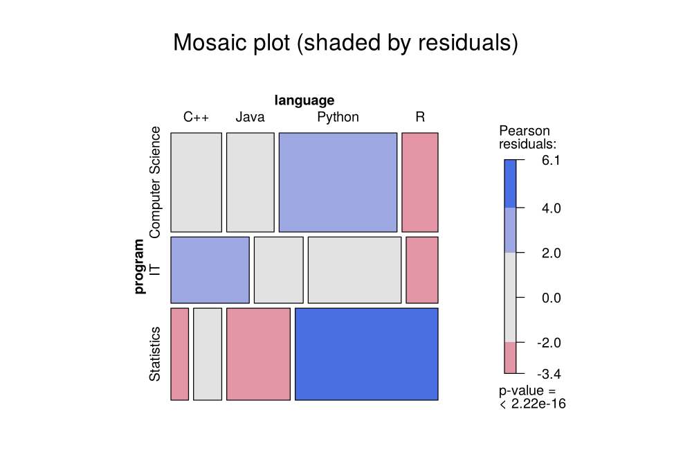

# Topic 17: Chi-square and categorical data analysis

**Course:** BIT 4131 Statistical Computing and Reporting

## 1. Theoretical explanation
The chi-square test of independence checks whether two categorical variables are associated by comparing observed counts to those expected under independence. The goodness-of-fit version compares one variable to a hypothesised distribution. Fisher's exact test suits small counts.

## 2. Mathematical formulation
- Expected: $E_{ij}=\frac{R_i C_j}{N}$
- $\chi^2=\sum\frac{(O_{ij}-E_{ij})^2}{E_{ij}}$, df $=(r-1)(c-1)$
- Cramér's V: $\sqrt{\frac{\chi^2}{N(\min(r,c)-1)}}$

## 3. Worked example
Hand-checkable example (full code in the scripts below).

```text
WORKED EXAMPLE: 2x2 table [[30, 20], [20, 30]]
Expected = row total x col total / grand total =
 [[25. 25.]
 [25. 25.]]
chi2 = sum((O-E)^2/E) = 4*(25/25) = 4.00; df = 1; p = 0.0455
```

## 4. Dataset analysis and implementation
| Language | Script | Console output |
|---|---|---|
| Python | [`python/analysis.py`](python/analysis.py) | [`outputs/results_python.txt`](outputs/results_python.txt) |
| R | [`r/analysis.R`](r/analysis.R) | [`outputs/results_r.txt`](outputs/results_r.txt) |

Datasets are in [`/data`](../../data) (reproducible synthetic data generated by `data/generate_datasets.py`, seed 4131).

## 5. Expected statistical output
See the two `results_*.txt` files above for the complete printed output (tables, test statistics, p-values, estimates).

## 6. Interpretation and visualisation
- chi2 = 91.2 with df = 6, p = 1.7e-17: programme and language preference are associated.
- Cramer's V = 0.34 indicates a strong association.
- Biggest contributors: Statistics/R (+6.1); Computer Science/R (-3.4); Statistics/C++ (-3.2)
- Gender and passing are independent here (Fisher p = 1.00).

### Figures
Files prefixed `py_` come from Python, `r_` from R.





