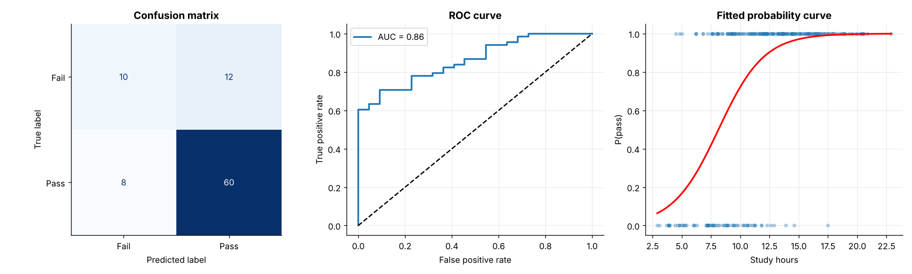
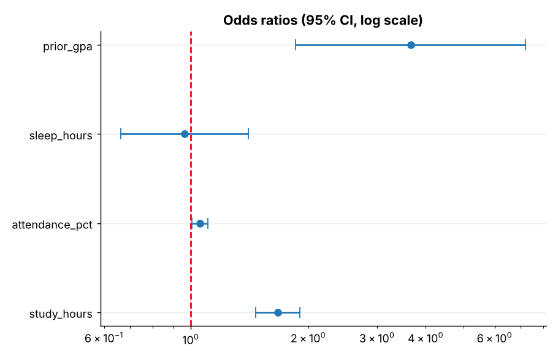
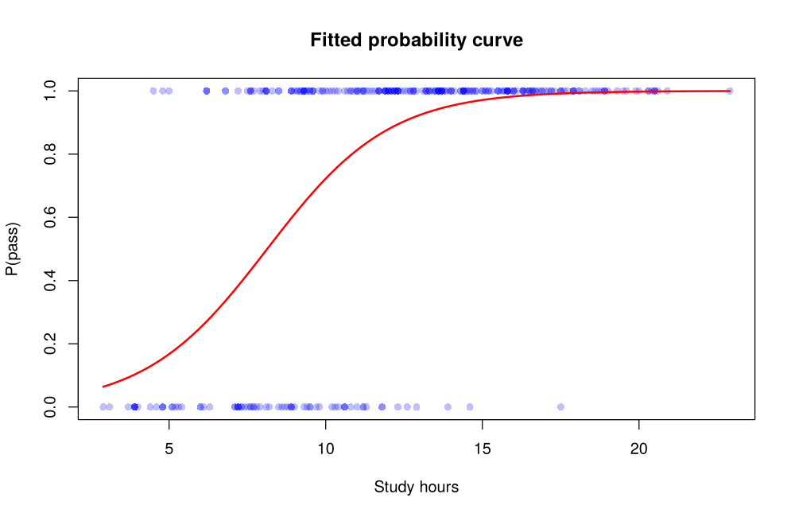
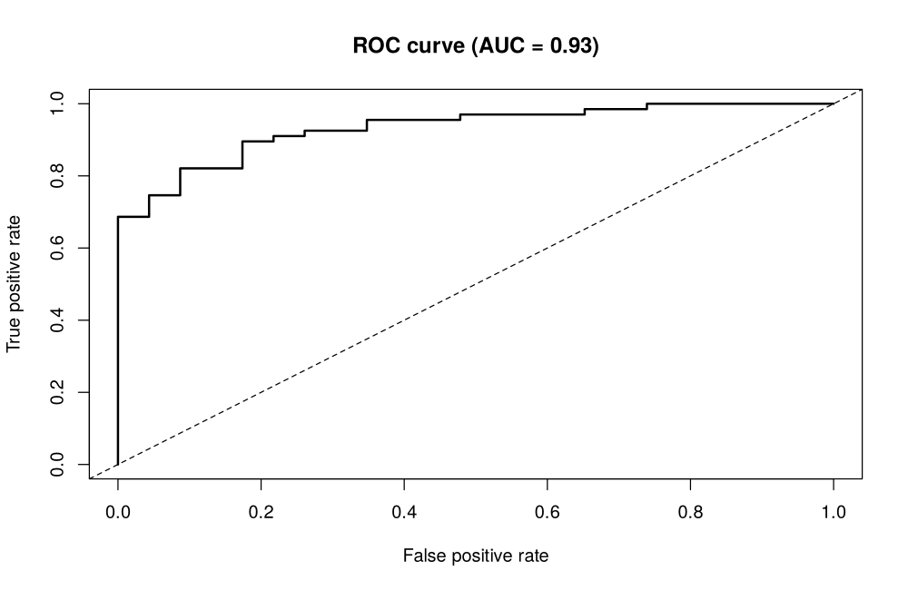

# Topic 18: Logistic regression

**Course:** BIT 4131 Statistical Computing and Reporting

## 1. Theoretical explanation
Logistic regression models a binary outcome. The log-odds are linear in the predictors; exp(coefficient) is the odds ratio. Predicted probabilities are thresholded to classify, and performance is judged with the confusion matrix, accuracy, precision, recall and ROC-AUC.

## 2. Mathematical formulation
- $\ln\frac{p}{1-p}=\beta_0+\beta_1x_1+\dots$, so $p=\frac{1}{1+e^{-\eta}}$
- Odds ratio $=e^{\beta_j}$
- Precision $=\frac{TP}{TP+FP}$, Recall $=\frac{TP}{TP+FN}$

## 3. Worked example
Hand-checkable example (full code in the scripts below).

```text
WORKED EXAMPLE: logit arithmetic
x =  4: log-odds = -2.0, odds = 0.135, P = 1/(1+e^-eta) = 0.119
x =  8: log-odds = +0.0, odds = 1.000, P = 1/(1+e^-eta) = 0.500
x = 12: log-odds = +2.0, odds = 7.389, P = 1/(1+e^-eta) = 0.881
Odds ratio per unit of x = e^0.5 = 1.649
```

## 4. Dataset analysis and implementation
| Language | Script | Console output |
|---|---|---|
| Python | [`python/analysis.py`](python/analysis.py) | [`outputs/results_python.txt`](outputs/results_python.txt) |
| R | [`r/analysis.R`](r/analysis.R) | [`outputs/results_r.txt`](outputs/results_r.txt) |

Datasets are in [`/data`](../../data) (reproducible synthetic data generated by `data/generate_datasets.py`, seed 4131).

## 5. Expected statistical output
See the two `results_*.txt` files above for the complete printed output (tables, test statistics, p-values, estimates).

## 6. Interpretation and visualisation
- study_hours: odds ratio 1.67 -> each unit increase multiplies the odds of passing by 1.67 (p = 1.8e-14).
- attendance_pct: odds ratio 1.06 -> each unit increase multiplies the odds of passing by 1.06 (p = 0.025).
- prior_gpa: odds ratio 3.66 -> each unit increase multiplies the odds of passing by 3.66 (p = 0.00018).
- Test accuracy is 78% versus a 76% baseline of always predicting 'pass': only a modest gain, because the classes are imbalanced, so accuracy alone is misleading.
- AUC = 0.86 and recall = 0.88 are more informative: the model ranks likely passers well above likely failers.
- Odds ratio > 1 raises the odds of the event; < 1 lowers it; 1 means no effect.

### Figures
Files prefixed `py_` come from Python, `r_` from R.





