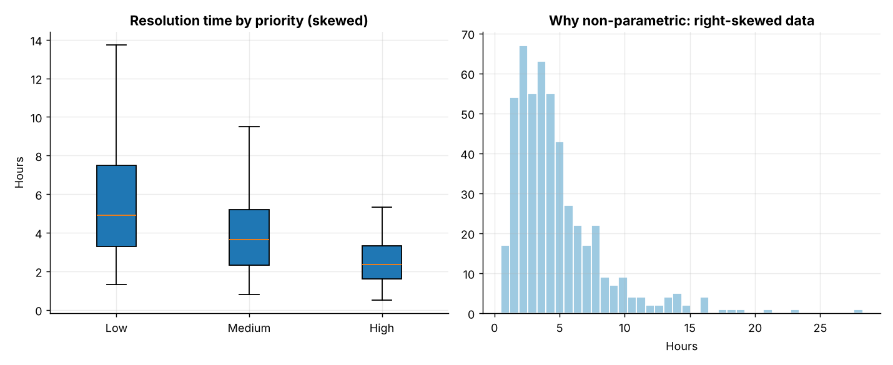
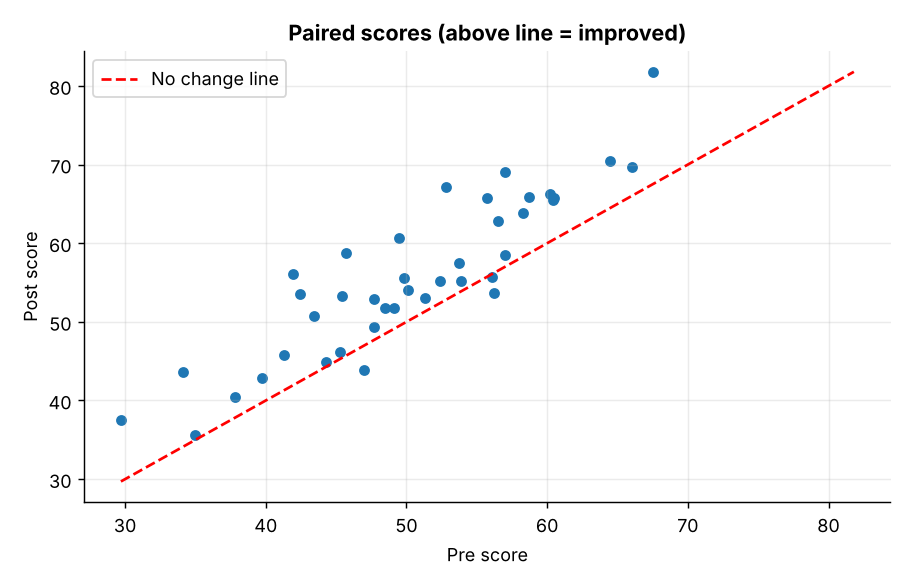
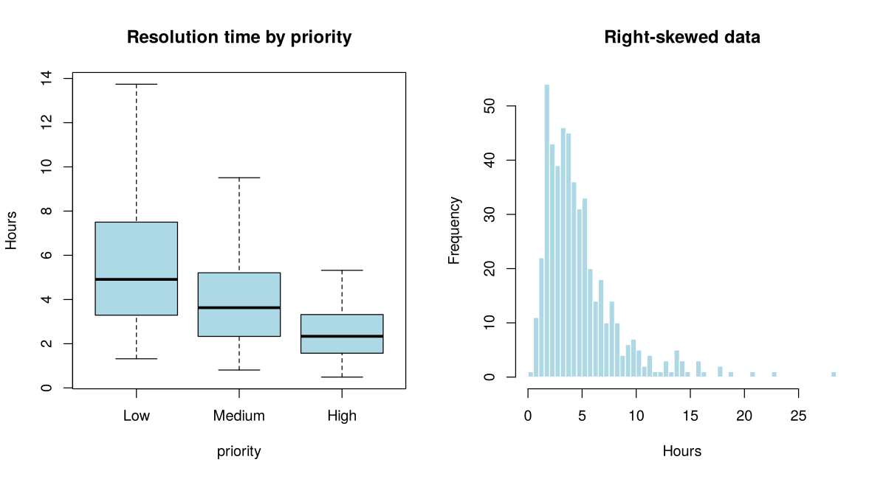
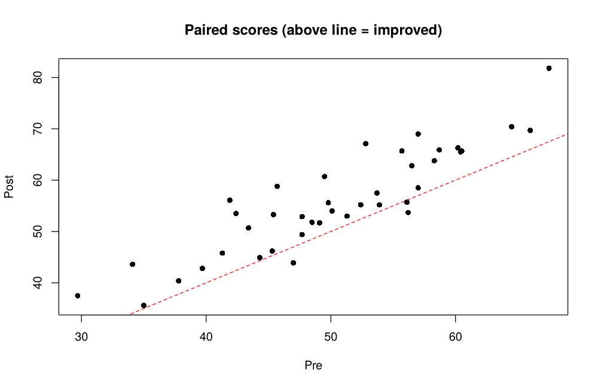

# Topic 19: Non-parametric statistical methods

**Course:** BIT 4131 Statistical Computing and Reporting

## 1. Theoretical explanation
Rank-based tests make no normality assumption, so they suit skewed data, ordinal data and small samples. Mann-Whitney (two independent groups), Kruskal-Wallis (3+ groups), Wilcoxon signed-rank (paired) and Spearman correlation replace their parametric counterparts.

## 2. Mathematical formulation
- Mann-Whitney: $U_1=R_1-\frac{n_1(n_1+1)}{2}$
- Kruskal-Wallis: $H=\frac{12}{N(N+1)}\sum\frac{R_i^2}{n_i}-3(N+1)$
- Spearman: $\rho=1-\frac{6\sum d_i^2}{n(n^2-1)}$

## 3. Worked example
Hand-checkable example (full code in the scripts below).

```text
WORKED EXAMPLE: Mann-Whitney U by hand
Combined ranks: [1. 3. 4. 2. 5. 6. 7.]  (a gets [1. 3. 4.] , b gets [2. 5. 6. 7.] )
R_a = 8.0;  U_a = R_a - n_a(n_a+1)/2 = 8.0 - 6 = 2.0;  scipy: 2.0
```

## 4. Dataset analysis and implementation
| Language | Script | Console output |
|---|---|---|
| Python | [`python/analysis.py`](python/analysis.py) | [`outputs/results_python.txt`](outputs/results_python.txt) |
| R | [`r/analysis.R`](r/analysis.R) | [`outputs/results_r.txt`](outputs/results_r.txt) |

Datasets are in [`/data`](../../data) (reproducible synthetic data generated by `data/generate_datasets.py`, seed 4131).

## 5. Expected statistical output
See the two `results_*.txt` files above for the complete printed output (tables, test statistics, p-values, estimates).

## 6. Interpretation and visualisation
- Resolution times are heavily skewed, so rank-based tests are safer than t-tests.
- Kruskal-Wallis (p = 4.4e-19) shows priority levels differ; High-priority tickets resolve in a median of 2.3h vs 4.9h for Low.
- Non-parametric and parametric tests agree on the paired tutoring data (Wilcoxon p = 2.1e-07): tutoring helped.
- Spearman (0.71) and Pearson (0.71) are similar because the relationship is roughly linear.

### Figures
Files prefixed `py_` come from Python, `r_` from R.





