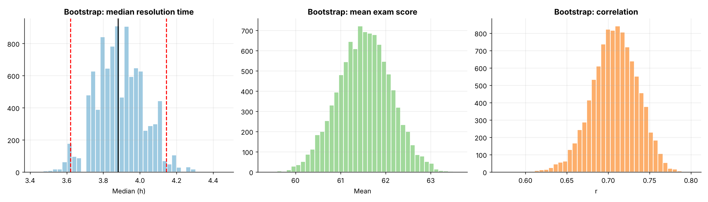
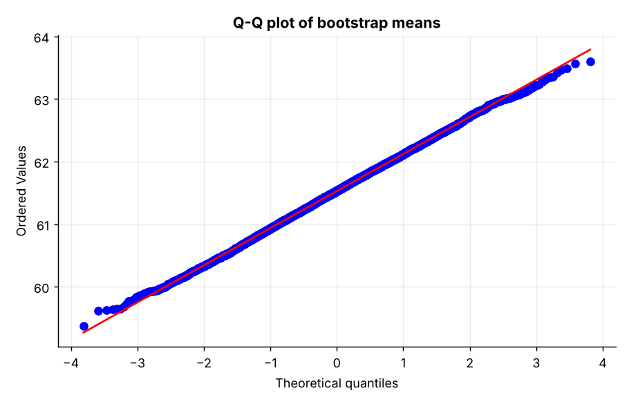
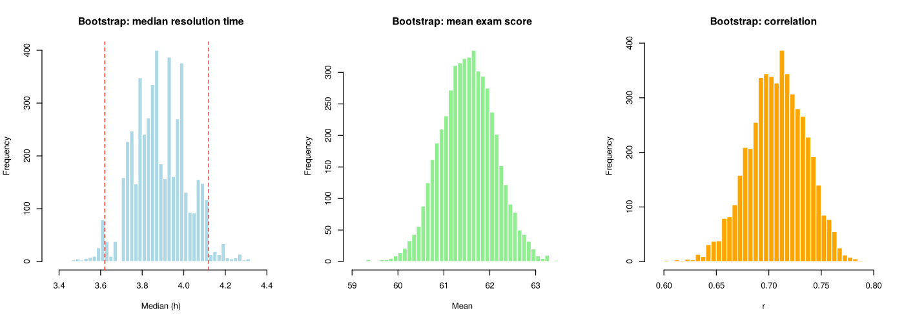

# Topic 20: Bootstrap and resampling methods

**Course:** BIT 4131 Statistical Computing and Reporting

## 1. Theoretical explanation
The bootstrap draws many samples with replacement from the observed data to approximate a statistic's sampling distribution. It yields standard errors and confidence intervals for statistics without a formula (median, correlation, ratios).

## 2. Mathematical formulation
- Resample $x^*_1..x^*_n$ with replacement, compute $\hat\theta^*_b$, $b=1..B$
- $SE_{boot}=\sqrt{\frac{1}{B-1}\sum(\hat\theta^*_b-\bar{\hat\theta}^*)^2}$
- Percentile CI: the 2.5% and 97.5% quantiles of $\hat\theta^*$

## 3. Worked example
Hand-checkable example (full code in the scripts below).

```text
WORKED EXAMPLE: one bootstrap resample of [3, 5, 7, 9, 11]
resample 1: [11  5  5  7 11]  -> mean 7.8
resample 2: [3 5 7 5 7]  -> mean 5.4
resample 3: [5 3 3 3 9]  -> mean 4.6
Sampling WITH replacement: values may repeat, others be left out.
```

## 4. Dataset analysis and implementation
| Language | Script | Console output |
|---|---|---|
| Python | [`python/analysis.py`](python/analysis.py) | [`outputs/results_python.txt`](outputs/results_python.txt) |
| R | [`r/analysis.R`](r/analysis.R) | [`outputs/results_r.txt`](outputs/results_r.txt) |

Datasets are in [`/data`](../../data) (reproducible synthetic data generated by `data/generate_datasets.py`, seed 4131).

## 5. Expected statistical output
See the two `results_*.txt` files above for the complete printed output (tables, test statistics, p-values, estimates).

## 6. Interpretation and visualisation
- The median has no easy SE formula, yet the bootstrap gives SE = 0.132h and a CI of (3.62, 4.14).
- For the mean, bootstrap and classical t-intervals nearly coincide: the bootstrap is trustworthy.
- Correlation and mean differences get honest uncertainty estimates without normality assumptions.
- The bootstrap approximates the sampling distribution by resampling the data itself.

### Figures
Files prefixed `py_` come from Python, `r_` from R.




