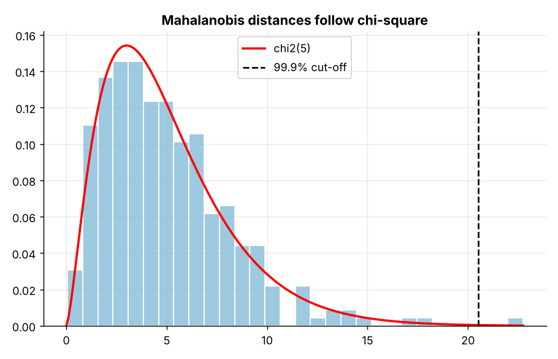
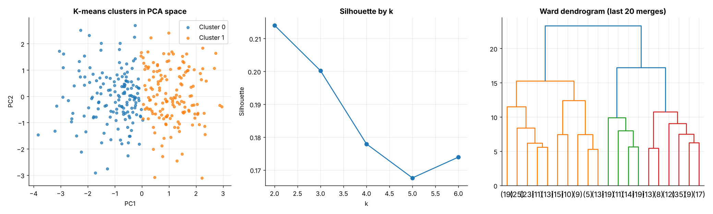
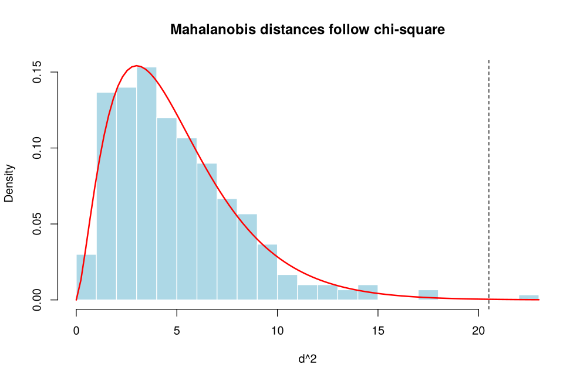
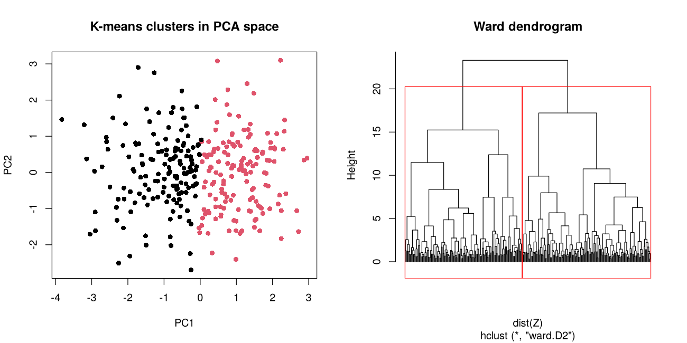

# Topic 21: Multivariate statistical analysis

**Course:** BIT 4131 Statistical Computing and Reporting

## 1. Theoretical explanation
Multivariate methods analyse several variables together: mean vector and covariance structure, Mahalanobis distance for multivariate outliers, MANOVA for group differences on several outcomes, and clustering (k-means, hierarchical) to find groups.

## 2. Mathematical formulation
- Mahalanobis: $D^2=(x-\mu)^\top\Sigma^{-1}(x-\mu)\sim\chi^2_p$
- k-means minimises $\sum_k\sum_{x\in C_k}\|x-\mu_k\|^2$
- Silhouette: $s=\frac{b-a}{\max(a,b)}$

## 3. Worked example
Hand-checkable example (full code in the scripts below).

```text
WORKED EXAMPLE: Mahalanobis distance in 2D
S =
 [[4. 2.]
 [2. 3.]] 
d^2 = (x-mu)' S^-1 (x-mu) = 1.5 -> d = 1.2247
Euclidean distance would be 2.8284 - Mahalanobis accounts for scale AND correlation.
```

## 4. Dataset analysis and implementation
| Language | Script | Console output |
|---|---|---|
| Python | [`python/analysis.py`](python/analysis.py) | [`outputs/results_python.txt`](outputs/results_python.txt) |
| R | [`r/analysis.R`](r/analysis.R) | [`outputs/results_r.txt`](outputs/results_r.txt) |

Datasets are in [`/data`](../../data) (reproducible synthetic data generated by `data/generate_datasets.py`, seed 4131).

## 5. Expected statistical output
See the two `results_*.txt` files above for the complete printed output (tables, test statistics, p-values, estimates).

## 6. Interpretation and visualisation
- MANOVA Wilks' lambda p = 4e-10: methods differ on the combined profile of outcomes.
- K-means picks k = 2 (best silhouette 0.21). Clusters differ most on study_hours and exam_score.
- A silhouette below ~0.25 means weak structure: the data form a continuum, so the clusters are a convenient split, not natural groups.
- Clusters do not line up with teaching method (ARI = 0.03, near 0), even though MANOVA finds method differences in means.
- Mahalanobis distance flags 1 unusual multivariate observation(s) that single-variable checks could miss.

### Figures
Files prefixed `py_` come from Python, `r_` from R.





