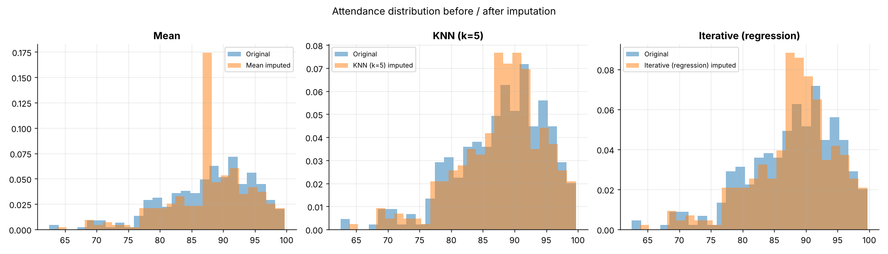
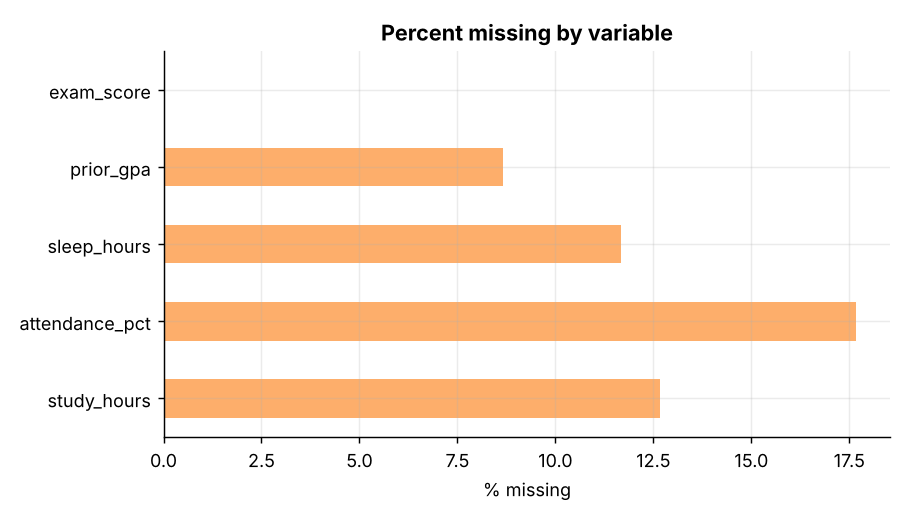
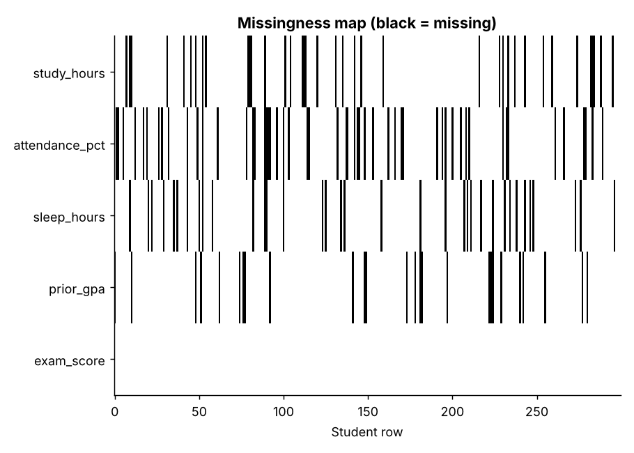
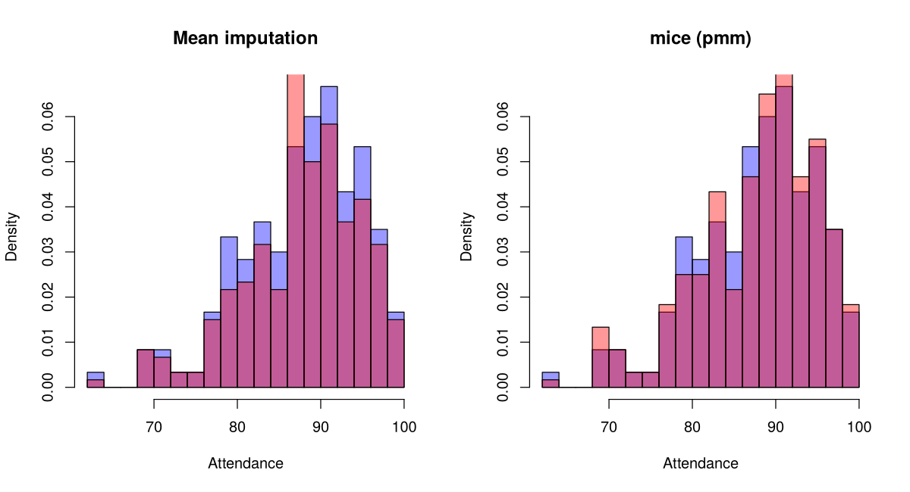
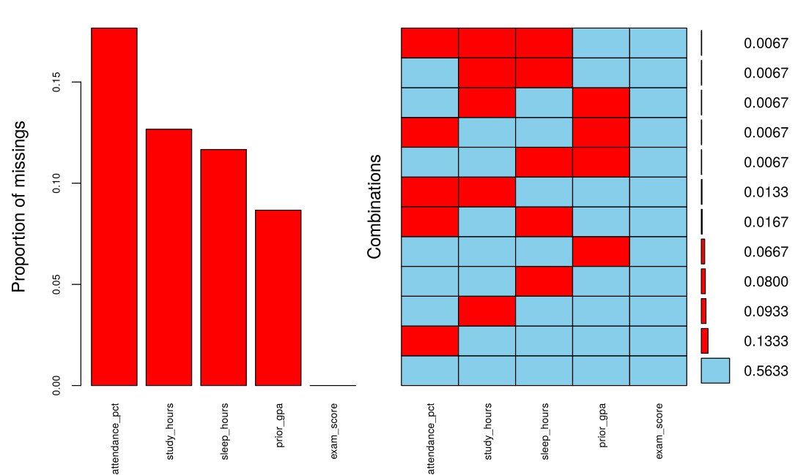

# Topic 22: Missing-data analysis and imputation

**Course:** BIT 4131 Statistical Computing and Reporting

## 1. Theoretical explanation
Missingness is MCAR (completely random), MAR (depends on observed data) or MNAR (depends on the missing value itself). Listwise deletion wastes data and can bias results; imputation (mean, regression/iterative, multiple imputation) fills gaps. Mean imputation shrinks variance.

## 2. Mathematical formulation
- Mean imputation: $\hat x_{miss}=\bar x_{obs}$
- Iterative (chained) imputation regresses each variable on the others in turn
- Rubin's rules (multiple imputation): $\bar Q=\frac1m\sum Q_i$, $T=\bar U+(1+\frac1m)B$

## 3. Worked example
Hand-checkable example (full code in the scripts below).

```text
WORKED EXAMPLE: mean imputation on [4, 6, NaN, 10]
observed mean = (4+6+10)/3 = 6.666666666666667 -> imputed series: [ 4.          6.          6.66666667 10.        ]
Note: mean imputation keeps the mean but SHRINKS the variance.
```

## 4. Dataset analysis and implementation
| Language | Script | Console output |
|---|---|---|
| Python | [`python/analysis.py`](python/analysis.py) | [`outputs/results_python.txt`](outputs/results_python.txt) |
| R | [`r/analysis.R`](r/analysis.R) | [`outputs/results_r.txt`](outputs/results_r.txt) |

Datasets are in [`/data`](../../data) (reproducible synthetic data generated by `data/generate_datasets.py`, seed 4131).

## 5. Expected statistical output
See the two `results_*.txt` files above for the complete printed output (tables, test statistics, p-values, estimates).

## 6. Interpretation and visualisation
- Listwise deletion would discard 44% of students: wasteful and potentially biased.
- Attendance missingness vs low GPA: Fisher p = 0.019 -> depends on an observed variable (MAR). Sleep: p = 0.52 -> consistent with MCAR.
- study_hours is imputed best by Iterative (regression) (RMSE 2.97 vs 4.13 for the mean): it is related to exam_score, which the model can exploit.
- attendance_pct is best imputed by Mean: it is only weakly related to the other variables, so model-based methods have little to add.
- Mean imputation shrinks the SD of attendance to 6.47 (true 7.12), understating uncertainty.
- Regression slope closest to the truth (1.724): Median (1.773). All methods land within 0.12 of it here.
- Lesson: there is no universally best imputation; the benefit depends on how strongly the missing variable relates to the rest.

### Figures
Files prefixed `py_` come from Python, `r_` from R.






