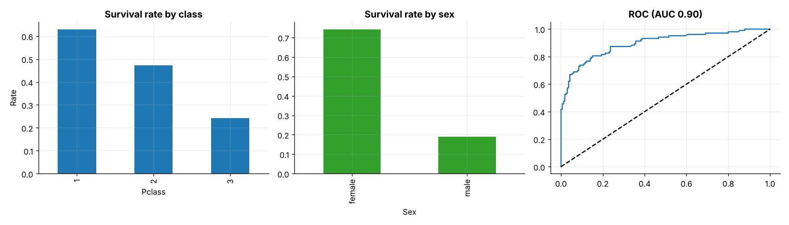
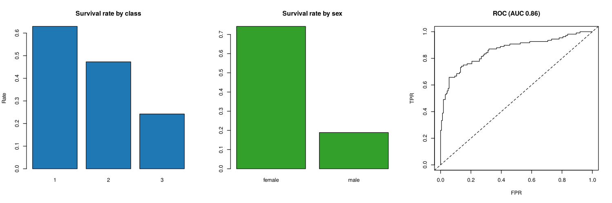

# Topic 24: Kaggle Titanic: missing data, chi-square, non-parametric tests and logistic regression

**Course:** BIT 4131 Statistical Computing and Reporting

## 1. Theoretical explanation
Real-data application of topics 17, 18, 19 and 22 to the Kaggle Titanic passenger list (891 rows). Age has genuine missing values, class and sex are categorical predictors of survival, and Fare is heavily right-skewed so a rank test is appropriate.

## 2. Mathematical formulation
- Chi-square: $\chi^2=\sum\frac{(O-E)^2}{E}$, Cramér's $V=\sqrt{\chi^2/(N(\min(r,c)-1))}$
- Logistic model: $\ln\frac{p}{1-p}=\beta_0+\sum\beta_jx_j$, odds ratio $=e^{\beta_j}$
- Mann-Whitney $U$ on ranks of Fare; group-median imputation for Age

## 3. Worked example

The hand-checkable worked examples for each technique are in the READMEs of the earlier topics this builds on: Topics 17 (chi-square), 18 (logistic), 19 (non-parametric) and 22 (missing data). This topic applies them to real data.

## 4. Dataset analysis and implementation
| Language | Script | Console output |
|---|---|---|
| Python | [`python/analysis.py`](python/analysis.py) | [`outputs/results_python.txt`](outputs/results_python.txt) |
| R | [`r/analysis.R`](r/analysis.R) | [`outputs/results_r.txt`](outputs/results_r.txt) |

Dataset: Kaggle: *Titanic - Machine Learning from Disaster* (`train.csv`), stored in [`/data/kaggle`](../../data/kaggle) (see its README for provenance).

## 5. Expected statistical output
See the two `results_*.txt` files above for the complete printed output (tables, test statistics, p-values, estimates).

## 6. Interpretation and visualisation
- Age is missing for 20% of passengers; group-median imputation keeps all rows but shrinks the age SD.
- Class and survival are strongly associated (chi2 = 102.9, p = 4.5e-23); sex is stronger still (chi2 = 260.7).
- Being male multiplies the odds of survival by 0.07; 3rd class by 0.09 (vs 1st).
- The model classifies 83% of held-out passengers correctly (AUC 0.90).

### Figures
Files prefixed `py_` come from Python, `r_` from R.

