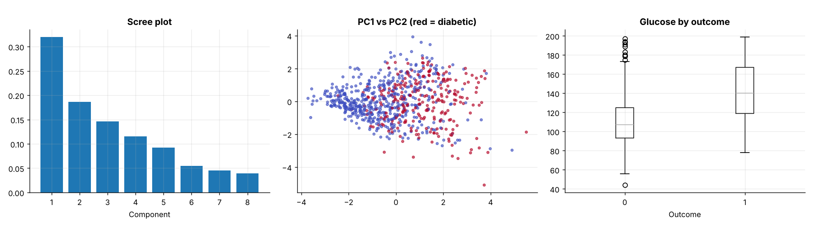
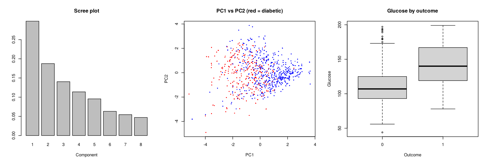

# Topic 25: Kaggle Pima Diabetes: hidden missing values, hypothesis tests and PCA

**Course:** BIT 4131 Statistical Computing and Reporting

## 1. Theoretical explanation
Real-data application of topics 6, 10 and 22. In the Pima data, impossible zeros (glucose, blood pressure, skin thickness, insulin, BMI) are really missing values; recognising them changes every summary. Group differences are tested with Welch t-tests and effect sizes, and PCA shows the covariance structure.

## 2. Mathematical formulation
- Welch $t=\frac{\bar x_1-\bar x_2}{\sqrt{s_1^2/n_1+s_2^2/n_2}}$, Cohen's $d=\frac{\bar x_1-\bar x_2}{s_p}$
- PCA: eigen-decomposition of the correlation matrix, ratio $\lambda_k/\sum\lambda_j$
- KNN imputation (Python) / group-median imputation (R)

## 3. Worked example

The hand-checkable worked examples for each technique are in the READMEs of the earlier topics this builds on: Topics 6 (hypothesis tests), 10 (PCA) and 22 (missing data). This topic applies them to real data.

## 4. Dataset analysis and implementation
| Language | Script | Console output |
|---|---|---|
| Python | [`python/analysis.py`](python/analysis.py) | [`outputs/results_python.txt`](outputs/results_python.txt) |
| R | [`r/analysis.R`](r/analysis.R) | [`outputs/results_r.txt`](outputs/results_r.txt) |

Dataset: Kaggle: *Pima Indians Diabetes Database* (`diabetes.csv`), stored in [`/data/kaggle`](../../data/kaggle) (see its README for provenance).

## 5. Expected statistical output
See the two `results_*.txt` files above for the complete printed output (tables, test statistics, p-values, estimates).

## 6. Interpretation and visualisation
- 49% of Insulin and 30% of SkinThickness values are coded 0 (really missing); leaving them in drags the Insulin mean from 156 to 80.
- Glucose differs strongly between groups (see Welch p and Cohen d above): the strongest single marker of diabetes here.
- The first two components explain 51% of the variance; no clean separation, so several variables are needed to classify.

### Figures
Files prefixed `py_` come from Python, `r_` from R.

