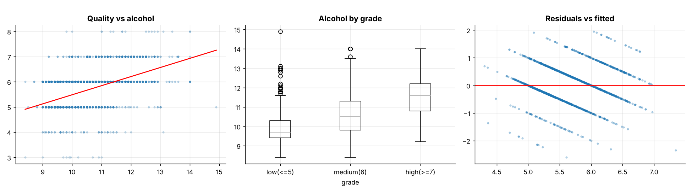
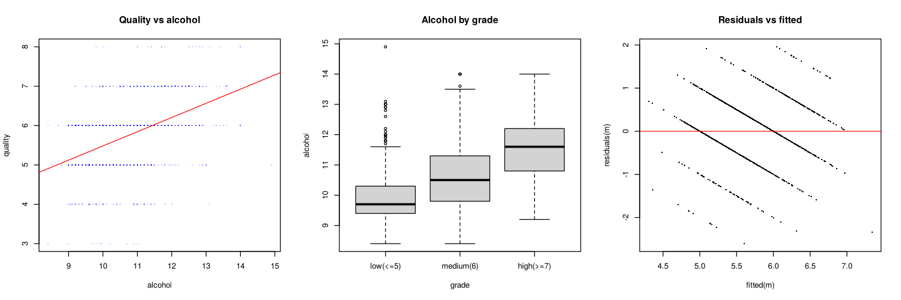

# Topic 26: Kaggle Red Wine Quality: correlation, regression, ANOVA and transformation

**Course:** BIT 4131 Statistical Computing and Reporting

## 1. Theoretical explanation
Real-data application of topics 7, 8, 15 and 16 to 1,599 red wines with 11 chemical measurements and a quality score. Correlation screens the predictors, multiple regression quantifies their joint effect (with VIF for multicollinearity), ANOVA compares alcohol across quality grades, and a log transform fixes a skewed variable.

## 2. Mathematical formulation
- Pearson $r=\frac{\operatorname{cov}(X,Y)}{s_Xs_Y}$; OLS $\hat\beta=(X^\top X)^{-1}X^\top y$; $R^2=1-SSE/SST$
- $VIF_j=\frac{1}{1-R_j^2}$
- ANOVA $F=\frac{SSB/(k-1)}{SSW/(N-k)}$, $\eta^2=SSB/SST$; Tukey HSD post-hoc

## 3. Worked example

The hand-checkable worked examples for each technique are in the READMEs of the earlier topics this builds on: Topics 7 (correlation), 8 (regression), 15 (transformation) and 16 (ANOVA). This topic applies them to real data.

## 4. Dataset analysis and implementation
| Language | Script | Console output |
|---|---|---|
| Python | [`python/analysis.py`](python/analysis.py) | [`outputs/results_python.txt`](outputs/results_python.txt) |
| R | [`r/analysis.R`](r/analysis.R) | [`outputs/results_r.txt`](outputs/results_r.txt) |

Dataset: Kaggle: *Red Wine Quality* (`winequality-red.csv`, from the UCI repository), stored in [`/data/kaggle`](../../data/kaggle) (see its README for provenance).

## 5. Expected statistical output
See the two `results_*.txt` files above for the complete printed output (tables, test statistics, p-values, estimates).

## 6. Interpretation and visualisation
- Alcohol has the strongest positive link with quality (r = 0.48); volatile acidity the strongest negative (-0.39).
- The model explains 36% of the variation in quality (adj R2 = 0.35): useful but far from complete.
- Each extra 1% alcohol is associated with +0.29 quality points, holding the other variables fixed.
- Mean alcohol differs across quality grades (F = 279.6, p = 8e-105); log transform reduces chlorides skew a lot.
- Quality is an integer score, so residuals are not perfectly normal; treat p-values as approximate.

### Figures
Files prefixed `py_` come from Python, `r_` from R.

