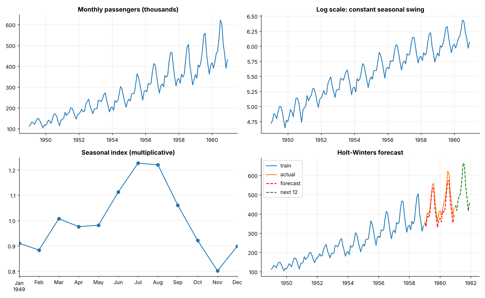
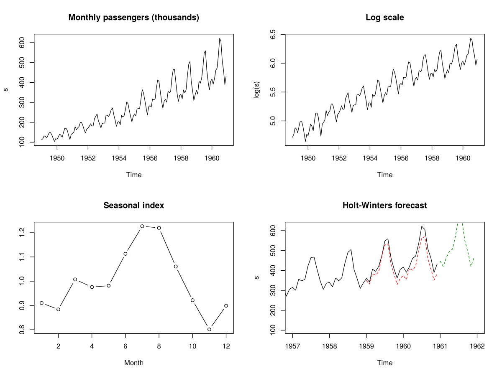

# Topic 27: Kaggle Air Passengers: time-series decomposition, stationarity and forecasting

**Course:** BIT 4131 Statistical Computing and Reporting

## 1. Theoretical explanation
Real-data application of topics 13 and 15 to monthly airline passengers 1949-1960 (144 points). The seasonal swing grows with the level, so the model is multiplicative (equivalently additive on the log scale). Differencing makes the series stationary, and Holt-Winters forecasts the last 24 months for validation.

## 2. Mathematical formulation
- Multiplicative model: $y_t=T_t\times S_t\times\varepsilon_t$, so $\ln y_t=\ln T_t+\ln S_t+\ln\varepsilon_t$
- ADF regression: $\Delta y_t=\alpha+\gamma y_{t-1}+\sum\delta_i\Delta y_{t-i}+e_t$ (test $\gamma=0$)
- Holt-Winters level/trend/seasonal smoothing; MAE, RMSE, MAPE

## 3. Worked example

The hand-checkable worked examples for each technique are in the READMEs of the earlier topics this builds on: Topics 13 (time series) and 15 (log transform). This topic applies them to real data.

## 4. Dataset analysis and implementation
| Language | Script | Console output |
|---|---|---|
| Python | [`python/analysis.py`](python/analysis.py) | [`outputs/results_python.txt`](outputs/results_python.txt) |
| R | [`r/analysis.R`](r/analysis.R) | [`outputs/results_r.txt`](outputs/results_r.txt) |

Dataset: Kaggle: *Air Passengers* (the classic Box-Jenkins airline series), stored in [`/data/kaggle`](../../data/kaggle) (see its README for provenance).

## 5. Expected statistical output
See the two `results_*.txt` files above for the complete printed output (tables, test statistics, p-values, estimates).

## 6. Interpretation and visualisation
- Traffic grew about 3.8x from 1949 to 1960 with a strong yearly cycle peaking in July and lowest in November.
- The seasonal swing widens as the level rises, so a multiplicative model (or log transform) is right; the raw series is non-stationary.
- After log + seasonal and ordinary differencing the series is stationary; Holt-Winters forecasts the last 2 years with MAPE 6.4%.

### Figures
Files prefixed `py_` come from Python, `r_` from R.

