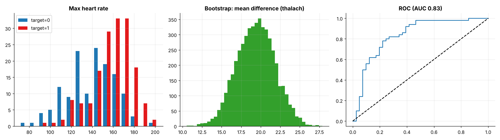
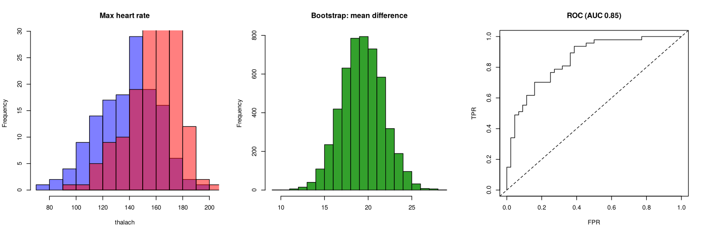

# Topic 28: Kaggle Heart Disease: confidence intervals, tests, bootstrap and logistic regression

**Course:** BIT 4131 Statistical Computing and Reporting

## 1. Theoretical explanation
Real-data application of topics 5, 6, 18 and 20 to the Cleveland heart-disease data (303 patients). Confidence intervals and Welch tests compare groups, the bootstrap checks the interval without distributional assumptions, and logistic regression predicts the label. **Data caveat:** in this Kaggle copy the label `target=1` goes with higher max heart rate and lower ST depression, which is the *lower-risk* direction clinically, although the dataset description says 1 = disease. Results follow the label as given.

## 2. Mathematical formulation
- CI for mean: $\bar x\pm t_{\alpha/2}\,s/\sqrt n$; Wilson interval for a proportion
- Bootstrap percentile CI of $\bar x_1-\bar x_2$ ($B=5000$)
- Logistic regression with odds ratios $e^{\beta_j}$; accuracy, recall and AUC

## 3. Worked example

The hand-checkable worked examples for each technique are in the READMEs of the earlier topics this builds on: Topics 5 (confidence intervals), 6 (hypothesis tests), 18 (logistic regression) and 20 (bootstrap). This topic applies them to real data.

## 4. Dataset analysis and implementation
| Language | Script | Console output |
|---|---|---|
| Python | [`python/analysis.py`](python/analysis.py) | [`outputs/results_python.txt`](outputs/results_python.txt) |
| R | [`r/analysis.R`](r/analysis.R) | [`outputs/results_r.txt`](outputs/results_r.txt) |

Dataset: Kaggle: *Heart Disease Dataset* (Cleveland, `dataset.csv`), stored in [`/data/kaggle`](../../data/kaggle) (see its README for provenance).

## 5. Expected statistical output
See the two `results_*.txt` files above for the complete printed output (tables, test statistics, p-values, estimates).

## 6. Interpretation and visualisation
- About 54% of patients carry label target=1 (95% CI 49% to 60%).
- Patients with target=1 reach a higher peak heart rate by 19.4 bpm (p = 5.0e-14); the bootstrap CI agrees with the t-test.
- Each extra unit of ST depression (oldpeak) multiplies the odds of target=1 by 0.51 (below 1 = lowers the odds, consistent with target=1 being the lower-risk label).
- The model reaches AUC 0.83 on held-out patients; recall 0.84 matters most in screening (missed cases).

### Figures
Files prefixed `py_` come from Python, `r_` from R.

